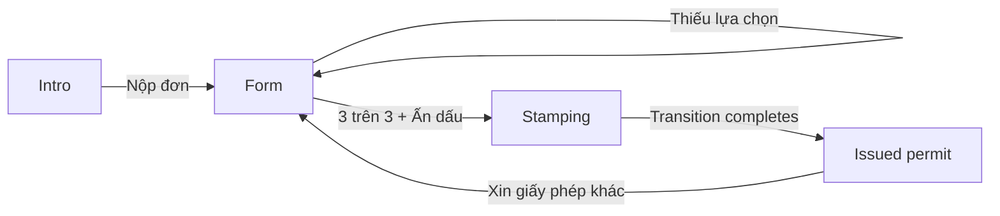

# Sở cấp phép nghỉ của Cục Yên · v1

Epic: [#15](https://github.com/vanphamvn/yen-nghi-choi/issues/15). Implementation workstream P1–P8, physical activation P9 postponed.

## Experience

The section `#tam-trang` is replaced in place, leaving the anchor stable for existing navigation.

**Scene 0 / waiting at counter:** A hand-drawn Cục Yên and a physical paper application over a wood-grain tabletop. CTA `NỘP ĐƠN XIN NGHỈ`.

**Scene 1 / paper form:** Three multi-choice fields with 4 decisions each. A one-tap red-brown desk stamp reads `CỤC YÊN`. Users can select/reselect any of the answers. All three are mandatory.

**Scene 2 / stamping:** Stamp dips on the paper; input locked; reduced-motion users receive the paper without the animation. The same issuance action cannot happen twice.

**Scene 3 / issued permit:** Paper transforms into a **purely playful permit** with a red stamp, three user choices, a brief Cục Yên note, and a menu item sourced from confirmed café menu ideas. Direct Google Maps link points to the exact URL already used on this site. `Xin giấy phép khác` resets to the application.

## Rules and copy contract

| Dimension | Allowed choice | Text used on permit |
|---|---|---|
| Reason | `noise` | Đầu hơi ồn |
| Reason | `deadline` | Trốn deadline chút |
| Reason | `busy` | Rảnh mà cứ bận |
| Reason | `why` | Không lý do |
| Style | `coffee` | Cà phê cho tỉnh → Cà phê đen nóng |
| Style | `tea` | Trà cho dịu → Trà atiso đường phèn mật ong |
| Style | `sweet` | Một chút ngọt → Cacao cốt dừa |
| Style | `fruit` | Trái cây mát → Nước ép thơm táo |
| Duration | `ten` | 10 phút |
| Duration | `cup` | Một ly nước |
| Duration | `song` | Một bài nhạc |
| Duration | `better` | Tới khi thấy ổn |

Menu matches are **static suggestions**, not actual live inventory, bookings, medical treatment or a discount.

**Legal and brand distinction:** `Giấy phép nghỉ tạm thời` is *only for fun*. It is not official permission, sick leave certification, a voucher or a receipt.

## Assets and page integration

- Entire permit markup, CSS and JS are currently in `index.html`, for reliable deployment in the static hosting setup.
- No external CDN or backend dependencies, network writes, account, identifier, cookie or local/session storage.
- All text lives in DOM for Vietnamese font compatibility; illustrated intro scene uses inline original SVG; CSS stamp uses shapes and high contrast.
- The retired 52-card Mood content/script is removed, reducing unused JS while preserving other games.
- Body intro/receipt content is visually generated with client-side string-safe `textContent` assignments only. Validated IDs are selected by fixed buttons.
- The URL is the preexisting Google Maps shortlink: `https://maps.app.goo.gl/zxpyZev8F6YyzL3c6?g_st=ic`.

## Interaction logic / state machine

State lives in JS scope. Repeated clicks in the stamping/issued phases cannot issue another permit. Timer is invalidated by a monotonically increasing round counter. No external service is called.

## QA checklist

- [x] JS syntax check for all scripts.
- [x] Mock DOM functional test: intro → incomplete validation → all fields → stamp → issued → restart.
- [x] Simulated second-click on stamp does not double-issue.
- [x] Menu and permit mapping **64 combinations (4 reasons × 4 styles × 4 durations)** with zero mismatches.
- [x] Branch Vercel preview returns HTTP 200 with permit markup and no old Mood rail.
- [ ] Visual smoke on iOS Safari and Android Chrome at 320/375/390/430px.
- [ ] Keyboard-only and screen-reader smoke in real browser.
- [ ] Confirm exact café map pin and final menu inventory before using for real-world marketing.
- [ ] Optional future physical QR activation after opening (P9).
