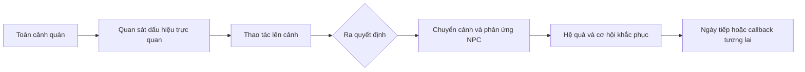

# Một Tháng Không Yên · roadmap visual novel 30 ngày

> **Status: PLANNED · đây là kế hoạch nội dung, không phải 90 cảnh đã code/art.** 
> Epic [#218](https://github.com/vanphamvn/yen-nghi-choi/issues/218). Nền MVP [#216](https://github.com/vanphamvn/yen-nghi-choi/issues/216) / [PR #217](https://github.com/vanphamvn/yen-nghi-choi/pull/217) đang triển khai riêng.
> Máy đọc: [episodes.json](episodes.json). Mọi mục `status: planned` cho đến khi có mã nguồn + ảnh thật + QA.

## 1. Hợp đồng sản phẩm

**Tên:** Một Tháng Không Yên (chế độ Campaign của Một Ca Không Yên).  
**Thời gian:** 30 **ngày trong game**, không phải 30 ngày thực / không khóa theo lịch.  
**Nhịp:** mỗi ngày 3 tình huống (sáng, chiều, tối); **30 × 3 = 90** tình huống chính, chưa gồm nhánh/biến thể.  
**Thời lượng mục tiêu:** 8–15 phút/ngày khi chơi trọn; có thể thoát sau từng tình huống. Không ép tốc độ.
**Đối tượng:** người chơi thích khám phá chuyện quán, có thể học cách ưu tiên an toàn, khách hàng, vận hành và tiền bạc. Đây là hư cấu, **không phải quy trình chuyên môn chính thức**.

### Trụ cột gameplay

1. **Nhìn ra vấn đề trước khi nói:** khi mỗi tình huống bắt đầu, quán có nhân vật, thiết bị, bối cảnh và dấu hiệu vật lý cụ thể để quan sát.
2. **Tương tác với cảnh:** ít nhất một thao tác có ý nghĩa (chọn điểm cần kiểm tra, dời vật cản, phân luồng order, soi nhãn, đánh dấu nguy cơ, ghép giao dịch, nói chuyện với NPC). **Không chấp nhận câu hỏi A/B/C đứng riêng trên ảnh nền không đổi.**
3. **Thấy hậu quả:** tối thiểu một thay đổi hiển thị trên cảnh và nét mặt/lời thoại nhân vật; trạng thái an toàn/không an toàn phải thể hiện bằng nội dung và hình ảnh, không chỉ màu.
4. **Ký ức kéo dài:** lựa chọn phù hợp thay đổi dụng cụ, bố trí, đoạn thoại, năng lực quán hoặc khách quay lại ở ngày sau; lỗi có đường sửa/nhận trách nhiệm, không game-over tùy tiện.
5. **Không biến thành ứng dụng theo dõi:** dữ liệu trong bộ nhớ phiên mặc định; muốn tiếp tục về sau thì tự chọn xuất/nhập mã lưu chỉ chứa trạng thái trò chơi, không có dữ liệu khách thật.

### Vòng chơi một tình huống

- 1 incident = **2–3 nhịp quyết định**, **2–4 lời/động tác phản ứng**, ít nhất **1 interaction không thuần text**; điều chỉnh theo độ khó, không áp chỉ tiêu khiến nội dung gượng.
- Dùng `shots` tối thiểu: **establishing → interactive → resolution**, plus **distinct resolution variants** khi các lựa chọn tạo kết quả khác nhau. Ba trạng thái không bắt buộc ba tranh vẽ độc lập: ghép từ background, actor pose, prop và effect nhưng khi nhìn phải khác nhau.
- **Điểm số chỉ là tín hiệu**, không có mẹo tối ưu bằng bỏ qua an toàn. Thứ tự ưu tiên khi tình huống cấp bách: an toàn con người > tính đúng/sự thật > giảm thiểu thiệt hại > tốc độ/chi phí.
- Trong biến cố nghiêm trọng: mô phỏng nhận diện nguy cơ và gọi người có thẩm quyền/trợ giúp khẩn khi thích hợp; không cung cấp chẩn đoán, hành động sơ cứu mơ hồ hoặc khẳng định tuân thủ pháp luật nếu chưa được đối chiếu.

## 2. Visual novel, không phải quiz có hình nền

**Mỗi ID Dxx-yy có 1 visual contract bắt buộc** trong bảng chương dưới đây. Trước khi đánh dấu done, phải có:

- **Establishing shot:** bối cảnh đúng nơi và thời điểm (quầy, sân, khu chơi, kho, cửa...) cùng các nhân vật/đạo cụ gắn trực tiếp với sự cố.
- **Interactive shot:** thao tác chạm thật lên vật thể hoặc không gian; hotspot có phản hồi rõ, keyboard focus + nút thay thế cho drag; không có thao tác bắt người chơi phải phản xạ nhanh.
- **Reaction shot:** bố cục/đạo cụ/di chuyển nhân vật hoặc nét mặt thay đổi *có nghĩa* theo quyết định; ít nhất hai phản ứng đối nghịch nếu nội dung có rủi ro.
- **Dialogue:** VN-style gồm ô thoại, speaker, biểu cảm, camera pan/cut có chủ đích; chữ thường ≥16px, choice target ≥44px, có skip/replay/thoát.
- **Visual accessibility:** mô tả alt/dấu hiệu bằng chữ cho phần thông tin quan trọng, reduced-motion tương đương, không chỉ dựa vào màu, âm thanh hoặc animation; có fallback khi asset lỗi.
- **Asset identity:** phối cảnh và sắc độ thống nhất art direction Yên hiện tại. Không lấy sprite Phaser lưu trữ làm chuẩn. Không dùng một ảnh phòng quán chung phủ lên 90 câu hỏi và gọi là hoàn thành.

### Bộ tài sản tái sử dụng (mục tiêu thiết kế, chưa sản xuất)

| Loại | Phạm vi đề xuất | Luật nhất quán |
|---|---|---|
| Backdrop nhiều góc nhìn | 12–15 bộ: quầy, nhận đơn, hàng chờ, khu trong nhà, tủ sách, góc trẻ em, sân vườn, cửa, bảng hiệu, kho, tủ lạnh, lavabo... | góc máy và scale đồ vật/cơ thể được khóa trên reference sheet |
| Ánh sáng/thời tiết | Sáng, trưa, chiều, tối, mất điện; mưa, nắng gắt, giông | bản chất vật thể vẫn đọc được trên mobile, không nháy đèn gây khó chịu |
| Nhân vật + biểu cảm | Chủ quán, người cùng ca, khách quen, học sinh, phụ huynh, bé, khách lớn tuổi, người giao hàng, hàng xóm... | mỗi nhân vật 3–6 pose/biểu cảm, không cần 90 NPC |
| Đạo cụ trạng thái | phiếu order, ly, thẻ mộc, tiền, máy POS, máy pha/xay, tủ lạnh, đá, nước đổ, biển trơn, ghế, ô, điện thoại, bảng ca... | mỗi incident có set đạo cụ riêng và before/after rõ ràng |
| Hiệu ứng | nước lan/được lau, vé trượt hàng chờ, đèn tắt, mưa đổ, nét mặt đổi, dấu mộc xuất hiện... | thông tin còn đủ khi bật reduce-motion |
| Góc quay | establishing, cận bằng chứng, over-the-shoulder, đối thoại 2 người, toàn cảnh sau xử lý | luân phiên trong tình huống, không đóng băng một góc máy |

**Ngân sách web ban đầu:** chỉ tải atlas/góc của ngày hiện tại; nén AVIF/WebP có fallback, ưu tiên ảnh đầu < 250 KB và JS+CSS nhỏ; đo kích cỡ thực bằng CI/browser trước khi chốt ngưỡng. Không đưa 90 ngày lên một màn menu.

## 3. Sơ đồ hệ quả xuyên tháng

Các cờ cốt truyện: `safety`, `queue`, `trust`, `cash`, `food`, `inventory`, `team`, `community`, `privacy`, `rain`, `flow`. Không dùng cờ này làm nhận định về sức khỏe con người.

| Gieo trước | Trả về sau | Minh họa trên màn hình |
|---|---|---|
| D01-02 vũng nước | D06-01 bé va bàn, D24-03 lối rửa tay, D30-01 sự cố cũ | biển cảnh báo, sàn và cách bố trí đồ vật còn/không còn |
| D02 mái hiên + D13 dột | D20 giông, D28 tiệc | dấu sửa chữa/ống thoát thực sự hiện hoặc thiếu |
| D03-01 hàng order + D09-02 chờ lâu | D26-01 đơn đặt trước, D30-01 | bảng thứ tự, nhịp hoạt động của NPC |
| D05 thiếu đá | D17-02 ngày nóng, D27-02 máy đá | dự trữ trong thùng, menu tạm hết món |
| D04 học sinh | D16 quay phim, D23 video, D30-02 khách quay lại | nhân vật đã gặp có nhận ra cách quán đối xử |
| D07 soát tiền | D22 tích mộc, D26 tiền lẻ, D29 quyết định | biên lai, dấu mộc, bảng tiền kế toán |
| D08 yêu cầu nguyên liệu | D19 lô sữa, D24 hỏi hồ sơ | nhãn, quy trình tách vật dụng xuất hiện |
| D10 mất điện | D27 tủ lạnh, D30 kiểm tra | nhật ký nhiệt độ hoặc đồ chưa được giải quyết |
| D11 thiếu người | D25 mâu thuẫn, D29 bố trí người | tư thế/biểu cảm đồng đội, bảng ca |
| D12 review + D18 hàng xóm | D23 mạng xã hội, D28 sinh nhật, D30 kết | khách xuất hiện/không xuất hiện và phản ứng cộng đồng |

## 4. Danh mục 90 tình huống và visual bắt buộc

**Mỗi dòng** nêu ít nhất: *sự cố cụ thể*, *cảnh phải thể hiện trên màn hình*, *thao tác trực quan người chơi phải được thực hiện*. Các mô tả dưới đây là **storyboard brief**, chưa phải tài sản đã vẽ.

### Tuần 1: Mở cửa và nhận diện rủi ro

#### Ngày 01 · Mở cửa

| ID · ca | Tình huống | Visual: thấy gì xảy ra | Thao tác trên cảnh | Cờ hệ quả |
|---|---|---|---|---|
| `D01-01` · Sáng | **Hàng khách đầu tiên** | Quầy sáng, dải 7 phiếu in dài dần; khách ở cửa sốt ruột, ly chưa có nhãn | Chạm phiếu, sắp thứ tự xử lý rồi nhìn hàng khách thay đổi | `queue` |
| `D01-02` · Chiều | **Vũng nước cạnh quầy** | Bình nghiêng, vũng nước loang sát lối đi; bé và khách tiến gần khu vực ướt | Đặt biển cảnh báo và ngăn lối trước khi lau; hình sàn đổi khô/ướt | `safety` |
| `D01-03` · Tối | **Hóa đơn khai trương** | Màn POS hiện combo lệch giá, khách chỉ vào biên lai và khay tiền | Chạm dòng sai, đối chiếu menu và sửa hóa đơn; khách đổi nét mặt | `cash` |

#### Ngày 02 · Mưa đầu mùa

| ID · ca | Tình huống | Visual: thấy gì xảy ra | Thao tác trên cảnh | Cờ hệ quả |
|---|---|---|---|---|
| `D02-01` · Sáng | **Cơn mưa tạt hiên** | Mưa chéo qua mái, giọt bắn lên ghế; nhóm khách co vào hiên | Di chuyển ghế vào vùng khô, đánh dấu chỗ trơn trên sơ đồ | `rain` |
| `D02-02` · Chiều | **Nước ở mép ổ điện** | Dòng nước chảy men tường gần ổ cắm; công tắc và dây điện hiện rõ | Khoanh vùng nguy hiểm, chọn gọi người có chuyên môn thay vì chạm thiết bị | `safety` |
| `D02-03` · Tối | **Đơn hàng ướt** | Người giao nguyên liệu che thùng giấy ướt, túi hàng có dấu nước | Kiểm tra từng kiện bằng thao tác mở/đối chiếu, tách hàng bị ảnh hưởng | `inventory` |

#### Ngày 03 · Một người trực quầy

| ID · ca | Tình huống | Visual: thấy gì xảy ra | Thao tác trên cảnh | Cờ hệ quả |
|---|---|---|---|---|
| `D03-01` · Sáng | **Máy xay và máy pha** | Cận cảnh hai máy hoạt động, hàng vé order treo dồn và đồng hồ chỉ giờ | Sắp thứ tự pha theo nhóm công đoạn thay vì bấm trắc nghiệm | `flow` |
| `D03-02` · Chiều | **Hai ly giống nhau** | Hai ly màu gần giống, nhãn tên lệch chỗ; hai khách chìa tay | Xoay và kiểm tra nhãn, đối chiếu phiếu rồi giao đúng ly | `trust` |
| `D03-03` · Tối | **Khách tới giờ đóng** | Đèn quán chuyển vàng tối, chổi dọn sàn và khách mới đứng ở cửa | Chọn vùng phục vụ còn an toàn và cập nhật bảng nhận món cuối | `team` |

#### Ngày 04 · Giờ tan trường

| ID · ca | Tình huống | Visual: thấy gì xảy ra | Thao tác trên cảnh | Cờ hệ quả |
|---|---|---|---|---|
| `D04-01` · Sáng | **Nhóm bạn chia tiền** | Bốn bạn đứng quanh quầy, điện thoại thanh toán và tiền lẻ trải trên bàn | Ghép số tiền từng bạn với đúng món, kiểm tra thiếu/thừa | `cash` |
| `D04-02` · Chiều | **Bàn nói chuyện lớn** | Nhóm học sinh ở một phía, khách đọc sách ở phía đối diện; các đường âm thanh xuất hiện | Chạm vị trí bàn, đề nghị đổi chỗ và xem biểu cảm hai nhóm | `community` |
| `D04-03` · Tối | **Cặp sách bị bỏ quên** | Một chiếc balô dưới ghế trong lúc khách ra về; lối đi dần vắng | Đưa vật vào điểm lưu giữ có nhãn, xác minh người nhận mà không công khai thông tin | `privacy` |

#### Ngày 05 · Ngày nhập nguyên liệu

| ID · ca | Tình huống | Visual: thấy gì xảy ra | Thao tác trên cảnh | Cờ hệ quả |
|---|---|---|---|---|
| `D05-01` · Sáng | **Thiếu đá cho giờ cao điểm** | Thùng đá gần cạn, bảng tồn kho báo ít, khách đặt đồ lạnh liên tục | Kéo lượng đá còn vào các nhóm đơn khả thi, đánh dấu món tạm hết | `inventory` |
| `D05-02` · Chiều | **Thơm dập trong thùng** | Thùng trái cây mở ra, quả lành và quả dập có dấu rõ | Phân loại từng quả, từ chối phần không đạt và cập nhật tồn kho | `food` |
| `D05-03` · Tối | **Nhãn trong tủ lạnh** | Cửa tủ mở, khay sữa/nguyên liệu có nhãn mờ và khay mới nhập | Sắp theo nhãn và điều kiện bảo quản đã kiểm chứng, không suy đoán hạn dùng | `food` |

#### Ngày 06 · Chủ nhật có trẻ nhỏ

| ID · ca | Tình huống | Visual: thấy gì xảy ra | Thao tác trên cảnh | Cờ hệ quả |
|---|---|---|---|---|
| `D06-01` · Sáng | **Bé va cạnh bàn** | Góc bàn sát lối, bé khóc và phụ huynh chạy tới; cốc nước rung trên mặt bàn | Đưa người hỗ trợ, đánh dấu góc bàn cần ngừng sử dụng và kiểm tra | `safety` |
| `D06-02` · Chiều | **Khu chơi quá đông** | Khu vui chơi hiện nhiều bé cùng tiến vào, đồ chơi nằm sát lối thoát | Di chuyển vật cản khỏi lối, phân khu hoạt động và báo phụ huynh | `safety` |
| `D06-03` · Tối | **Xe đẩy chắn cửa** | Xe đẩy dựng ngay cửa ra vào, người khác đang đẩy cửa | Chọn vị trí gửi xe đẩy, kiểm tra đường đi thoáng trên sơ đồ | `flow` |

#### Ngày 07 · Khép tuần đầu

| ID · ca | Tình huống | Visual: thấy gì xảy ra | Thao tác trên cảnh | Cờ hệ quả |
|---|---|---|---|---|
| `D07-01` · Sáng | **Cuối ca lệch tiền** | Sổ tiền mặt và POS đặt cạnh nhau, một dòng thu chưa khớp | Đối chiếu hóa đơn với khay tiền và đánh dấu khoản chênh cần tìm | `cash` |
| `D07-02` · Chiều | **Ly nước bị quên** | Ly làm xong nằm lại trên quầy; giờ nhận nước trôi qua | Truy lại phiếu, kiểm tra chất lượng món trước khi giao hay làm lại | `trust` |
| `D07-03` · Tối | **Lịch ca tuần tới** | Bảng ca trực đầy ô trống, người cùng ca đang nghỉ mệt | Kéo thẻ công việc vào lịch, giữ khung nghỉ và dự phòng khách đông | `team` |

### Tuần 2: Lời hứa với khách và quy trình vận hành

#### Ngày 08 · Khách muốn tự chọn

| ID · ca | Tình huống | Visual: thấy gì xảy ra | Thao tác trên cảnh | Cờ hệ quả |
|---|---|---|---|---|
| `D08-01` · Sáng | **Ly ít ngọt** | Khách chỉ vào vạch đường trên bảng công thức, ly mẫu đặt cạnh nhau | Dùng thanh chỉnh trực quan mức ngọt, xác nhận bằng nhãn in lên ly | `trust` |
| `D08-02` · Chiều | **Yêu cầu tránh thành phần dị ứng** | Thành phần trên khay và dụng cụ chạm nhau; khách hỏi cách chuẩn bị | Kiểm tra bảng thành phần và điểm giao nhau dụng cụ, không bảo đảm an toàn khi chưa chắc | `food` |
| `D08-03` · Tối | **Bình riêng của khách** | Bình cá nhân đưa qua quầy; miệng bình có vết bẩn và khay rửa đang bận | Quan sát trạng thái bình, chọn quy trình từ chối/nhận theo điều kiện vệ sinh | `food` |

#### Ngày 09 · Cao điểm trưa

| ID · ca | Tình huống | Visual: thấy gì xảy ra | Thao tác trên cảnh | Cờ hệ quả |
|---|---|---|---|---|
| `D09-01` · Sáng | **Hai vé giống số** | Hai phiếu cùng số nhưng giờ khác; khay nước đang được chuyển đi | So phiếu với thời điểm và mã món, gỡ trùng trước khi giao | `flow` |
| `D09-02` · Chiều | **Khách đợi quá lâu** | Hàng khách đổi tư thế, đồng hồ trôi và số thứ tự còn nằm trong máy | Đặt lại thứ tự, chạm khách cần thông báo để cập nhật trung thực | `trust` |
| `D09-03` · Tối | **Siro lỡ tay** | Cận bình siro rót quá vạch, màu ly đổi đậm; khách cần ít ngọt | Kiểm tra thể tích, chọn làm lại nếu không thể sửa đạt yêu cầu | `food` |

#### Ngày 10 · Ngày cúp điện

| ID · ca | Tình huống | Visual: thấy gì xảy ra | Thao tác trên cảnh | Cờ hệ quả |
|---|---|---|---|---|
| `D10-01` · Sáng | **Máy xay dừng ngang** | Đèn vụt tắt, máy xay đứng im, đèn báo nguồn nhấp nháy | Ngừng thiết bị an toàn và chỉ định khu vực điện cần kiểm tra bởi người phù hợp | `safety` |
| `D10-02` · Chiều | **Tủ lạnh im tiếng** | Cửa tủ đóng, nhãn nhiệt độ và thời gian mất điện hiện trên khung | Ghi mốc thời gian, kiểm tra dữ liệu nhiệt độ, phân loại nguyên liệu có căn cứ | `food` |
| `D10-03` · Tối | **POS mất kết nối** | Màn thu ngân tối, khách cầm mã thanh toán chưa được xác nhận | Kiểm tra trạng thái giao dịch trước khi chốt, dùng quy trình dự phòng không trùng thu | `cash` |

#### Ngày 11 · Thiếu người một buổi

| ID · ca | Tình huống | Visual: thấy gì xảy ra | Thao tác trên cảnh | Cờ hệ quả |
|---|---|---|---|---|
| `D11-01` · Sáng | **Người cùng ca đến muộn** | Đồng hồ chuyển, tạp dề treo trống trong khi bàn bắt đầu đông | Phân vai lại trên sơ đồ trạm, đánh dấu công việc chưa có người xử lý | `team` |
| `D11-02` · Chiều | **Pha chế mới đọc sai nhãn** | Người học việc bối rối trước hai chai màu giống nhau | Chạm nhãn để kiểm tra, hướng dẫn từ trạm an toàn thay vì đoán | `team` |
| `D11-03` · Tối | **Không ai kịp nghỉ** | Hai người trong quầy có tư thế mệt, phiếu đơn vẫn đến | Điều chỉnh nhịp nhận đơn và lượt nghỉ qua bảng ca | `team` |

#### Ngày 12 · Một sao trên mạng

| ID · ca | Tình huống | Visual: thấy gì xảy ra | Thao tác trên cảnh | Cờ hệ quả |
|---|---|---|---|---|
| `D12-01` · Sáng | **Khách quay lại quầy** | Khách chỉ ly nước và màn đánh giá, người phía sau quan sát | Mở phiếu order gốc trên bàn, lắng nghe rồi xác minh điểm chưa khớp | `trust` |
| `D12-02` · Chiều | **Ảnh cắt mất ngữ cảnh** | Màn hình điện thoại phóng một khung ảnh, góc rộng hiện câu chuyện khác | Đổi giữa khung cắt và toàn cảnh, kiểm tra bằng chứng trước phản hồi | `privacy` |
| `D12-03` · Tối | **Phản hồi công khai** | Giao diện bài đánh giá với ô soạn nháp, thông tin cá nhân bị lộ trong bản nháp | Che dữ liệu riêng và chọn nội dung đáp có trách nhiệm, không gây tranh cãi công khai | `privacy` |

#### Ngày 13 · Mái hiên bị dột

| ID · ca | Tình huống | Visual: thấy gì xảy ra | Thao tác trên cảnh | Cờ hệ quả |
|---|---|---|---|---|
| `D13-01` · Sáng | **Nước nhỏ gần đèn** | Giọt nước chạy dọc thanh mái đến đèn và dây điện | Khoanh vùng, chọn ngắt/kiểm tra theo quy trình an toàn, không tự sửa khi nguy hiểm | `safety` |
| `D13-02` · Chiều | **Ghế vườn ướt** | Các vệt nước rơi xuống bộ bàn ghế ngoài sân | Di chuyển bàn theo bản đồ vùng khô, đổi vị trí khách có trao đổi | `rain` |
| `D13-03` · Tối | **Nước chảy sang sân cạnh** | Máng thoát và vệt nước đi về ranh sân hàng xóm | Đặt hướng xử lý thoát nước có kiểm tra, trao đổi trực tiếp thay vì đẩy nước đi | `community` |

#### Ngày 14 · Đêm chơi board game

| ID · ca | Tình huống | Visual: thấy gì xảy ra | Thao tác trên cảnh | Cờ hệ quả |
|---|---|---|---|---|
| `D14-01` · Sáng | **Thiếu một quân cờ** | Hộp trò chơi mở, một ô cờ trống, khách lục dưới bàn | Soi các vị trí đồ đạc, kiểm tra danh sách mảnh trước khi kết luận | `flow` |
| `D14-02` · Chiều | **Tranh cãi về luật** | Hai nhóm chỉ vào lá bài, nét mặt căng dần | Chọn cách đưa luật tham khảo/đổi game trên bàn và xem phản ứng | `community` |
| `D14-03` · Tối | **Ồn khi gần đóng cửa** | Đồng hồ gần giờ đóng, âm lượng nhóm tăng, nhà bên cạnh tắt đèn | Giảm âm thanh của không gian, thống nhất giờ kết thúc với khách | `community` |

### Tuần 3: Khách quen, người xung quanh và sự cố khó

#### Ngày 15 · Khách quen và ưu tiên

| ID · ca | Tình huống | Visual: thấy gì xảy ra | Thao tác trên cảnh | Cờ hệ quả |
|---|---|---|---|---|
| `D15-01` · Sáng | **Khách quen xin làm trước** | Khách quen bước đến bên cạnh hàng số thứ tự, người đang chờ nhìn sang | Di chuyển đơn trên bảng hàng chờ và nhìn phản ứng người đến trước | `trust` |
| `D15-02` · Chiều | **Thẻ tám mộc** | Thẻ tích điểm có bảy dấu, khách nói đủ tám; phiếu mua nằm cạnh | Đếm mộc và đối chiếu giao dịch hợp lệ với khách | `cash` |
| `D15-03` · Tối | **Nợ một ly mai trả** | Khách quen chưa mang tiền, hóa đơn đang treo | Chọn xử lý minh bạch trong quy định quán, ghi nhận bằng cách không lộ dữ liệu riêng | `community` |

#### Ngày 16 · Những chiếc điện thoại

| ID · ca | Tình huống | Visual: thấy gì xảy ra | Thao tác trên cảnh | Cờ hệ quả |
|---|---|---|---|---|
| `D16-01` · Sáng | **Quay phim dính mặt khách** | Một điện thoại giơ cao, khung hình bắt trúng khách bàn bên | Di chuyển góc máy hoặc yêu cầu dừng quay, màn hình mô phỏng vùng riêng tư | `privacy` |
| `D16-02` · Chiều | **Nước sát ổ điện** | Nhóm học sinh để ly nước sát thiết bị sạc | Kéo ly khỏi nguy cơ, chỉ khu vực dùng đồ uống phù hợp | `safety` |
| `D16-03` · Tối | **Bạn quên ví** | Một bạn trẻ bối rối trước quầy, bạn bè đứng phía sau | So lại món đã giao và cách thanh toán hợp lệ, tránh làm khách xấu hổ | `trust` |

#### Ngày 17 · Trưa nóng như rang

| ID · ca | Tình huống | Visual: thấy gì xảy ra | Thao tác trên cảnh | Cờ hệ quả |
|---|---|---|---|---|
| `D17-01` · Sáng | **Bàn sân nắng gắt** | Vệt nắng dịch qua ghế, khách lấy tay che mặt, cây ngoài sân héo | Chọn vị trí có bóng râm và điều chỉnh bố trí ghế | `flow` |
| `D17-02` · Chiều | **Thùng đá gần hết** | Máy làm đá báo không đủ, menu đồ lạnh vẫn sáng | Chỉ định hạn mức đơn và cập nhật món tạm ngưng nhận | `inventory` |
| `D17-03` · Tối | **Khách choáng vì nóng** | Một khách ôm đầu ngồi xuống, người đi cùng tìm nước và chỗ mát | Dọn đường hỗ trợ, gọi hỗ trợ y tế khi có dấu hiệu nghiêm trọng; không tự chẩn đoán | `safety` |

#### Ngày 18 · Chuyện với hàng xóm

| ID · ca | Tình huống | Visual: thấy gì xảy ra | Thao tác trên cảnh | Cờ hệ quả |
|---|---|---|---|---|
| `D18-01` · Sáng | **Xe chắn lối đi** | Xe khách dựng lấn cổng bên cạnh, người hàng xóm đang dắt xe ra | Chuyển vị trí đỗ trên sơ đồ có giới hạn thực tế | `community` |
| `D18-02` · Chiều | **Nhạc vang sau 21 giờ** | Loa trong nhà hiện vòng âm, cửa hàng xóm khép lại | Điều chỉnh mức âm và vị trí loa, hỏi hàng xóm nhu cầu thực tế | `community` |
| `D18-03` · Tối | **Khói bay vào bàn** | Khói từ một vị trí ngoài sân trôi về nhóm khách khác | Chỉ định khu vực không ảnh hưởng người khác, trao đổi nội quy rõ ràng | `safety` |

#### Ngày 19 · Giá nguyên liệu đổi

| ID · ca | Tình huống | Visual: thấy gì xảy ra | Thao tác trên cảnh | Cờ hệ quả |
|---|---|---|---|---|
| `D19-01` · Sáng | **Nhà cung cấp tăng giá** | Hai phiếu báo giá đặt cạnh nhau, giá mới được khoanh đỏ | So giá, định lượng và chất lượng trước khi quyết định menu | `inventory` |
| `D19-02` · Chiều | **Thiếu cốt dừa** | Ngăn nguyên liệu vắng một chai, món cốt dừa vẫn ở menu | Khóa món tạm hết và đề nghị thay thế chỉ sau khi khách đồng ý | `trust` |
| `D19-03` · Tối | **Lô sữa có vấn đề** | Khay sữa có mã lô khác thường và dấu hiệu bảo quản chưa rõ | Cách ly lô, đối chiếu điều kiện lưu trữ/nguồn hàng, không thử bằng mùi | `food` |

#### Ngày 20 · Cơn giông lớn

| ID · ca | Tình huống | Visual: thấy gì xảy ra | Thao tác trên cảnh | Cờ hệ quả |
|---|---|---|---|---|
| `D20-01` · Sáng | **Biển bạt rung mạnh** | Biển treo phía trước bị gió giật, dây giữ kéo căng | Khoanh vùng phía dưới và gọi đơn vị phù hợp kiểm tra cố định | `safety` |
| `D20-02` · Chiều | **Ghế ngoài sân bị xô** | Gió hất khăn và làm ghế chuyển chỗ, khách đứng dậy | Thu đồ an toàn, dời khách khỏi khu nguy hiểm | `rain` |
| `D20-03` · Tối | **Miệng thoát nước nghẹt** | Lá cây gom quanh rãnh, mực nước dâng về cửa quán | Chặn khu trơn và sắp thứ tự kiểm tra vệ sinh khi điều kiện an toàn | `safety` |

#### Ngày 21 · Ngày quá đông

| ID · ca | Tình huống | Visual: thấy gì xảy ra | Thao tác trên cảnh | Cờ hệ quả |
|---|---|---|---|---|
| `D21-01` · Sáng | **Phụ huynh tìm bé** | Khu khách nhiều người, ghế che khuất tầm nhìn, phụ huynh gọi tên con | Đánh dấu lối cần rà soát, phân công tìm an toàn và liên hệ người có trách nhiệm | `safety` |
| `D21-02` · Chiều | **Khách có dấu hiệu cần trợ giúp** | Một khách ngồi khuỵu, người đi cùng ra hiệu, lối ra bị đông người | Giải phóng lối tiếp cận và gọi hỗ trợ khẩn theo dấu hiệu, tránh chẩn đoán trong game | `safety` |
| `D21-03` · Tối | **Đám đông giơ máy quay** | Nhiều điện thoại cùng hướng vào người gặp sự cố | Chọn vị trí che tầm quay, mời tôn trọng riêng tư, giữ không gian hỗ trợ | `privacy` |

### Tuần 4: Danh tiếng, con người và áp lực tích lũy

#### Ngày 22 · Thẻ mộc gặp trục trặc

| ID · ca | Tình huống | Visual: thấy gì xảy ra | Thao tác trên cảnh | Cờ hệ quả |
|---|---|---|---|---|
| `D22-01` · Sáng | **Hai thẻ cùng ghi một lượt** | Hai thẻ mộc đặt cạnh hai biên lai, khách chỉ vào mộc vừa đóng | Đối chiếu lượt mua và kết quả đóng dấu, sửa công bằng | `trust` |
| `D22-02` · Chiều | **Quà đổi mộc hết hàng** | Ngăn quà trống, khách đã đặt thẻ đủ mộc lên quầy | Chọn phương án thông báo và quyền nhận bù có thể thực hiện | `inventory` |
| `D22-03` · Tối | **Dấu đóng sai chỗ** | Nhân viên mới cầm mộc, thẻ đã có vết mực lem | Chọn cách xử lý thẻ lỗi, kiểm tra số lượt không làm khách mất quyền lợi | `team` |

#### Ngày 23 · Yên xuất hiện trên mạng

| ID · ca | Tình huống | Visual: thấy gì xảy ra | Thao tác trên cảnh | Cờ hệ quả |
|---|---|---|---|---|
| `D23-01` · Sáng | **Khung quay dính người lạ** | Máy quay dựng cạnh bàn và khung preview hiện mặt khách chưa đồng ý | Thay góc máy, cắt vùng có người hoặc dừng ghi hình | `privacy` |
| `D23-02` · Chiều | **Video bị hiểu sai** | Một đoạn ngắn và cảnh trước-sau đặt trên storyboard song song | Sắp mảnh diễn biến đúng thứ tự trước khi viết lời giải thích | `trust` |
| `D23-03` · Tối | **Tài khoản giả đăng ưu đãi** | Hai trang xã hội có logo gần giống, khách giơ điện thoại hỏi | Đối chiếu kênh chính thức và soạn cảnh báo không lộ thông tin khách | `privacy` |

#### Ngày 24 · Khách kiểm tra ghé quán

| ID · ca | Tình huống | Visual: thấy gì xảy ra | Thao tác trên cảnh | Cờ hệ quả |
|---|---|---|---|---|
| `D24-01` · Sáng | **Hỏi hồ sơ vệ sinh** | Bàn giấy tờ với tập hồ sơ và nhiệt kế/tủ lạnh ở phía sau | Tìm đúng hồ sơ có sẵn, chỉ rõ điểm chưa có thay vì dựng số liệu | `food` |
| `D24-02` · Chiều | **Chứng từ đặt nhầm chỗ** | Bìa giấy lẫn giữa menu và biên nhận, người kiểm tra đang chờ | Sắp lại chứng từ theo nhóm, thừa nhận phần chưa xác minh | `cash` |
| `D24-03` · Tối | **Lối rửa tay bị chắn** | Lavabo và thùng hàng chặn nửa lối, người cùng ca cần dùng | Di chuyển thùng, mở lối và nhìn trạng thái sử dụng thay đổi | `safety` |

#### Ngày 25 · Hai người không cùng nhịp

| ID · ca | Tình huống | Visual: thấy gì xảy ra | Thao tác trên cảnh | Cờ hệ quả |
|---|---|---|---|---|
| `D25-01` · Sáng | **Hai người làm trùng đơn** | Cả hai cùng cầm ly giống nhau, bảng phân công bị xóa mờ | Gắn nhãn người phụ trách mỗi trạm, tránh làm trùng | `team` |
| `D25-02` · Chiều | **Bàn giao ca thiếu thông tin** | Sổ ca mở ở trang trống, một nguyên liệu hết chưa được báo | Điền thẻ tình trạng đơn, tồn kho và thiết bị trên bảng bàn giao | `team` |
| `D25-03` · Tối | **Căng thẳng trước khách** | Người cùng ca nhìn đi chỗ khác, khách ngồi gần nghe được câu tranh luận | Chọn dừng tranh cãi công khai, phân công tiếp tục phục vụ rồi trao đổi riêng | `team` |

#### Ngày 26 · Đêm đông không ngờ

| ID · ca | Tình huống | Visual: thấy gì xảy ra | Thao tác trên cảnh | Cờ hệ quả |
|---|---|---|---|---|
| `D26-01` · Sáng | **Đơn đặt trước tràn quầy** | Hàng phiếu đặt trước phủ kín bàn pha, đơn tại chỗ mới tới | Phân luồng cam kết đã nhận và năng lực làm món, cập nhật thời gian thực tế | `flow` |
| `D26-02` · Chiều | **Ghế chật lối ra** | Bàn ghế thêm vào làm lối đi hẹp, nhóm khách muốn ghép bàn | Kéo sơ đồ bàn ghế, giữ lối an toàn và báo giới hạn chỗ | `safety` |
| `D26-03` · Tối | **Tiền lẻ và ly mang về** | Khay tiền lẻ trống cạnh chồng ly cuối; khách đang thanh toán | Kiểm tra lựa chọn thanh toán và tồn bao bì trước khi nhận thêm món | `cash` |

#### Ngày 27 · Máy móc phản đối

| ID · ca | Tình huống | Visual: thấy gì xảy ra | Thao tác trên cảnh | Cờ hệ quả |
|---|---|---|---|---|
| `D27-01` · Sáng | **Máy xay cà phê kẹt** | Núm máy đứng yên, hạt kẹt trong phễu và đèn cảnh báo | Dừng nguồn đúng cách, kiểm tra theo hướng dẫn thay vì cố quay | `safety` |
| `D27-02` · Chiều | **Đá tan trong thùng** | Nước chảy ở đáy thùng, menu đồ đá vẫn đang mở | Đánh dấu lượng đá còn dùng được và món cần tạm dừng | `inventory` |
| `D27-03` · Tối | **Báo động nhiệt tủ lạnh** | Màn nhiệt độ vượt vùng cho phép, khay sữa có nhãn giờ nhập | Đọc nhật ký nhiệt độ, cách ly nguyên liệu không đủ căn cứ an toàn | `food` |

#### Ngày 28 · Buổi sinh nhật nhỏ

| ID · ca | Tình huống | Visual: thấy gì xảy ra | Thao tác trên cảnh | Cờ hệ quả |
|---|---|---|---|---|
| `D28-01` · Sáng | **Dây trang trí chắn cửa** | Bóng và dây buộc qua lối đi, trẻ chạy quanh ghế | Thay vị trí dây/bóng bằng kéo-thả, giữ thông thoáng lối ra | `safety` |
| `D28-02` · Chiều | **Nhóm hát hơi lớn** | Bàn sinh nhật hát, khách ngồi bên cạnh đưa mắt nhìn, người nhà ở sân ngoài | Điều chỉnh khu vực và trao đổi giới hạn âm lượng với người đặt bàn | `community` |
| `D28-03` · Tối | **Rác sau tiệc** | Ly giấy và bóng vỡ ở sân, thùng phân loại sắp đầy | Phân loại rác, xử lý mảnh vỡ và kiểm tra sân trước khi đón khách mới | `safety` |

### Kết: Ngã rẽ và ngày cuối của tháng

#### Ngày 29 · Chọn cách lớn lên

| ID · ca | Tình huống | Visual: thấy gì xảy ra | Thao tác trên cảnh | Cờ hệ quả |
|---|---|---|---|---|
| `D29-01` · Sáng | **Đề nghị bán giao tận nơi** | Người đề xuất giao hàng đưa bảng đơn, quầy có hai người với lịch kín | Thử bố trí một đơn giao trên lịch và thấy ai phải rời quầy | `team` |
| `D29-02` · Chiều | **Nên thêm người hay bớt món** | Bảng menu dày, lịch làm ca và chi phí hiển thị cạnh nhau | Gỡ/giữ món trên bảng năng lực, thử phương án nhân sự với ngân sách | `inventory` |
| `D29-03` · Tối | **Hợp đồng nguyên liệu mới** | Hai mẫu hợp đồng và khay nguyên liệu khác giá, yêu cầu chất lượng khác nhau | So điều kiện giao, bảo quản và đổi trả trước khi lựa chọn | `food` |

#### Ngày 30 · Đêm cuối của tháng

| ID · ca | Tình huống | Visual: thấy gì xảy ra | Thao tác trên cảnh | Cờ hệ quả |
|---|---|---|---|---|
| `D30-01` · Sáng | **Sự cố cũ quay lại** | Lối đi và góc quầy có chi tiết sửa chữa hoặc bỏ ngỏ tùy các cờ ngày trước | Tìm dấu nguy cơ trong cảnh, kích hoạt quy trình đã chọn trước đó | `safety` |
| `D30-02` · Chiều | **Khách quen trở lại** | Một hoặc nhiều nhân vật từng gặp trở lại với biểu cảm/phụ kiện thay đổi theo ký ức câu chuyện | Tương tác trực tiếp với nhân vật, phản hồi thay đổi theo mức tin tưởng | `trust` |
| `D30-03` · Tối | **Tắt đèn đóng cửa** | Máy pha yên, bảng tiền và ghế dọn gọn hoặc hỗn độn tùy hành trình; cửa quán khép dần | Kiểm tra cuối ca bằng thao tác vật thể, mở cảnh kết phù hợp trạng thái tháng | `ending` |

## 5. Vertical slice phải làm trước khi sản xuất 90 tình huống

**Ngày 01 gồm 3 tình huống hoàn chỉnh**, không phải 3 đoạn text với cùng một ảnh phòng.

**D01-01 · Hàng khách đầu tiên:** wide shot trước quầy có dòng khách → cận vé order → người chơi sắp phiếu theo công suất và thứ tự → camera quay lại hàng khách, có người được báo thời gian hoặc bực vì bỏ quên.

**D01-02 · Vũng nước cạnh quầy:** bình đổ và nước lan rõ trên nền → người chơi chạm biển cảnh báo, đặt vào lối đi và khoanh khu vực → theo lựa chọn, hiện sàn khô/an toàn hoặc lối còn ướt, khách né, có cơ hội sửa lại. Tình huống này là điểm **safety gate**, không được coi bỏ qua nguy cơ để pha nhanh là phương án tốt.

**D01-03 · Hóa đơn khai trương:** cận POS, biên lai và các cốc đặt trên khay → người chơi đối chiếu giá món/bill thực → khách phản ứng khác nhau, quầy thu ngân thể hiện số dư mới.

**Các màn bắt buộc:** chọn ngày, intro chuyển ca, story scene, inspect/drag/hotspot, hội thoại, phản ứng, summary cuối ngày, nút tiếp/nghỉ/chơi lại. Khi chưa có art thật, để nội dung ở trạng thái planned; không ghi “visual complete”.

## 6. Production architecture và chống bùng nổ nhánh

- `campaignState`: ngày hiện tại, incident hiện tại, bốn thước đo hiện có, flags dài hạn, biến thể nhân vật, kho hàng giả lập, chi tiết sửa chữa, các mốc đã gặp. Không chứa dữ liệu khách ngoài đời.
- `incident`: `id`, `day`, `timeSlot`, `prerequisites`, `scene`, `shotRefs`, `actors`, `interactions`, `choices`, `reactionMap`, `effects`, `repairPaths`, `callbackFlags`, `next`.
- **Branch & foldback:** cho 2–3 giải pháp và kết quả cục bộ khác nhau, sau đó ghép về trục ngày kế với flags khác; các nhánh phụ điều chỉnh visual/NPC/phương tiện. Không viết cây nhánh vô hạn.
- **Hành vi không hợp lệ:** thao tác lỗi có phản hồi và lối thử lại; không thể thao tác với một vật đã biến mất. Chỉ số được giới hạn, kết quả an toàn không phụ thuộc “min/max” chi phí.
- **Tiến độ:** cho chơi 30 ngày liên tục theo thứ tự nhưng được tạm dừng tự nguyện, mở lại chương đã qua. Nếu chọn lưu, tạo mã save offline do người chơi giữ; không tự lưu/tải tên, mood hay thông tin cá nhân. Không dùng localStorage ngầm.
- **Cách kết thúc:** ít nhất 3 ending khác nhau bằng **cảnh vật và NPC** (quán ổn định; vận hành quá tải nhưng đang sửa; mất niềm tin/đang khôi phục). Không có thông điệp chế giễu người chơi hoặc kết thúc “bị phạt vì làm an toàn”.

## 7. Release roadmap và ticket breakdown

Thứ tự là **phụ thuộc kỹ thuật**, không phải ngày hẹn. Một PR / ticket phải tạo giá trị kiểm thử thật và không đánh dấu production nếu chưa verify deploy.

| Stage | Ticket | Giao hàng | Gate |
|---|---|---|---|
| Foundation | [VN-F01 #219](https://github.com/vanphamvn/yen-nghi-choi/issues/219) | Story engine + flags và data schema | kiểm đường đi và transition |
| Art foundation | [VN-F02 #220](https://github.com/vanphamvn/yen-nghi-choi/issues/220) | Visual bible + layer/pose manifest + pipeline | sample sprite/contact sheet ở kích thước thực |
| Interaction | [VN-F03 #221](https://github.com/vanphamvn/yen-nghi-choi/issues/221) | Reusable inspect/drag/scene state | touch + keyboard + reduce-motion |
| **Playable pilot** | [VN-F04 #222](https://github.com/vanphamvn/yen-nghi-choi/issues/222) | **Ngày 01 cả 3 incident có hình**, play + outcome | browser screenshots + QA + preview |
| Story pack 1 | [VN-P01 #223](https://github.com/vanphamvn/yen-nghi-choi/issues/223) | Ngày 02–07: 18 incidents | visuals + callbacks + CI |
| Story pack 2 | [VN-P02 #224](https://github.com/vanphamvn/yen-nghi-choi/issues/224) | Ngày 08–14: 21 incidents | visuals + callbacks + CI |
| Story pack 3 | [VN-P03 #225](https://github.com/vanphamvn/yen-nghi-choi/issues/225) | Ngày 15–21: 21 incidents | visuals + callbacks + CI |
| Story pack 4 | [VN-P04 #226](https://github.com/vanphamvn/yen-nghi-choi/issues/226) | Ngày 22–28: 21 incidents | visuals + callbacks + CI |
| Ending | [VN-P05 #227](https://github.com/vanphamvn/yen-nghi-choi/issues/227) | Ngày 29–30 + ending visual | callback đầy đủ + replay |
| Privacy/progress | [VN-F05 #228](https://github.com/vanphamvn/yen-nghi-choi/issues/228) | resume offline tự nguyện + replay | dữ liệu/restore/migration tests |
| Final QA | [VN-F06 #229](https://github.com/vanphamvn/yen-nghi-choi/issues/229) | E2E 30 ngày + release gate | green CI, art review, SHA production |

**Bàn giao theo ngày:** khi sản xuất story pack, chia nhỏ PR thành ngày hoặc tối đa nhóm 2–3 ngày có thể chơi, không đẩy 21 tình huống chỉ một lần trước khi kiểm tra. Mỗi PR ghi rõ ID đã done. Không merge nhân vật/ảnh có phong cách khác với canonical reference.

## 8. QA và quy tắc nghiệm thu từng incident

Mỗi `Dxx-yy` chỉ được `done` khi:

- [ ] Có **3 visual states** với ít nhất một sự thay đổi nhìn thấy có nghĩa, đúng sự cố, không dùng background duy nhất lặp.
- [ ] Tương tác với vật thể/hotspot/cảnh chạy thật và có hướng dẫn rõ. Có keyboard/touch alternative và fallback.
- [ ] Sau 2–3 quyết định, thoại/biểu cảm/đồ vật và flags phản hồi đúng; có repair path nếu lựa chọn xấu; các đường hợp lệ đều kết thúc.
- [ ] Có alt text hoặc văn bản tương đương cho tín hiệu quan trọng; 320, 360, 390, 768, 1440 viewport không clip hoặc tràn.
- [ ] Kiểm tra contrast, ít nhất 44×44 touch target, focus, reduced-motion, exit/replay/skip, file ảnh tải lỗi.
- [ ] Asset có nguồn/bản quyền phù hợp, không tải thư viện/bên thứ ba ngoài contract.
- [ ] Browser screenshot ở mobile và desktop được kiểm tra trực quan, không gọi test logic là art signoff.
- [ ] CI xanh và **đúng production URL/SHA** nếu issue đánh dấu released; preview không được gọi production.

### Test tự động cho campaign

1. `catalog: 30 days × 3 incidents = 90 unique IDs`; mỗi ID có visual establishing, interactive, resolution, mechanic, và callback fields.
2. Asset references resolution tồn tại, không để icon/sprite thiếu và không dùng cùng ảnh placeholder làm bằng chứng cho 90 scenes.
3. Path exploration/bounded fuzz: không dead-end, cùng một tình huống không cho double apply effect, mọi ending reachable.
4. Snapshot scene before/action/after cho incident thuộc release; visual regressions trên mobile và desktop.
5. Test những chuỗi D01→D06→D30, D10→D27, D12→D23, D18→D28 và các tình huống liên quan an toàn, privacy.
6. Simulate unsupported asset/low bandwidth, refresh, exit/replay, invalid save code.
7. Release gate riêng cho 30 ngày; **không giả hoàn thành những phần chưa được làm**.

## 9. Ngoài phạm vi MVP campaign

Không multiplayer, không livestream khách thật, không selfie/camera/mic bắt buộc, không dùng dữ liệu POS thực, không thu thông tin khách, không phát livestream hình ảnh trẻ em, không có thông báo daily retention hay tính năng bắt người chơi quay lại đúng 30 ngày đời thực.

**Next engineering move:** Hoàn tất MVP [PR #217](https://github.com/vanphamvn/yen-nghi-choi/pull/217) và triển khai [#219](https://github.com/vanphamvn/yen-nghi-choi/issues/219) + [#220](https://github.com/vanphamvn/yen-nghi-choi/issues/220) → [#221](https://github.com/vanphamvn/yen-nghi-choi/issues/221) → [#222](https://github.com/vanphamvn/yen-nghi-choi/issues/222). Không tạo hàng loạt ảnh trước khi Day 1 được duyệt về scale/style.
