# Yên Lab · M2 Core Beta 3 release gate (LAB-F11, #135)

Ngày: 20/11/2026 · Cổng M2: **ba trò Thở cùng Yên, Căng rồi thả, Ba điều nhỏ xíu cùng mở trên sổ thực đơn**, chơi trọn một lượt khách từ phòng → sổ → từng trò → về phòng.

Ba trò đã lên production qua các PR riêng (#179 G01, #183 G02, #185 G14). Cổng này không thêm trò mới; nó kiểm cả ba **cùng nhau** và sửa một lỗi nhỏ tìm được trong lúc kiểm.

## Thay đổi trong cổng này

- `tests/yen-lab-beta3.spec.mjs` (mới, chạy trong CI qua `playwright.lab-ux.config.mjs`, và trên điện thoại giả lập khi `LAB_UX_DEVICES=1`):
  - **Một lượt khách:** phòng → mở sổ → từng trò trong 3 trò → chơi đến hết → “về góc ngồi chơi” → trò tiếp theo. Không lỗi console/JS, không HTTP ≥ 400, không cookie/localStorage/sessionStorage, không `<audio>/<video>`.
  - **Không có âm thanh:** đếm mọi đường có thể phát tiếng (Web Audio, `HTMLMediaElement.play`, speech synthesis, rung). Cả 3 trò: 0.
  - **Chữ biết ơn không rời trang:** gõ một chuỗi đánh dấu vào Ba điều nhỏ xíu, xong; phát `pagehide` (như khi trang vào bộ nhớ back/forward) thì chữ biến mất ngay; rời sang trò khác rồi bấm back: chữ không còn trong trang hay ô nhập; không request nào (URL hoặc body, kể cả dạng mã hóa URL) chứa chuỗi đó; không request ra domain khác; không IndexedDB.
  - **Offline sau khi tải:** mỗi trò, sau khi trang tải xong thì ngắt mạng, vẫn chơi đến hết và **không gọi mạng lần nào**.
  - **Cold load:** mỗi trang Beta trong context trống cache; ngân sách < 900 KB, ≤ 25 request, 0 bên thứ ba. Số đo bên dưới.
- `lab/lab.css`: tắt vệt xanh khi chạm (`-webkit-tap-highlight-color`) trên nút/link của phòng. Trước đây chạm cuốn sổ trên Android Chrome làm hiện một ô xanh đè lên tranh (thấy trong ảnh Pixel 7 lúc kiểm). Các trang trò đã có dòng này trong `game.css`. Viền focus bàn phím giữ nguyên.

Không đổi engine, CSP, nội dung an toàn hay copy trò.

## Checklist #135

| Tiêu chí | Kết quả | Bằng chứng |
| --- | --- | --- |
| Cả 3 trò hoàn thành hoặc dừng được bằng touch/keyboard | ✅ | Lượt khách 3 trò bằng chạm (emulated-touch, iPhone 15, Pixel 7) và chuột (desktop); spec từng trò có bàn phím đầy đủ: `yen-lab-tho` / `-cang` / `-ba-dieu` “keyboard …” và dừng/làm lại |
| Chữ biết ơn không leak, hủy sạch khi rời | ✅ | `yen-lab-beta3` (request, storage, back/forward, IndexedDB) + `yen-lab-ba-dieu` (pagehide/bfcache, refresh, dừng/làm lại xóa ngay) |
| PMR có lựa chọn bỏ qua nếu đau/căng | ✅ | Căng rồi thả: bỏ chọn phần đang đau trước khi bắt đầu, “bỏ qua chỗ này” khi đang chơi, chế độ chỉ thả lỏng; câu cảnh báo cơ của SAFETY.md ngay trên nút bắt đầu |
| Trò thở không áp đặt 4-6, có thông báo ngừng nếu khó chịu | ✅ | Thở cùng Yên: 3 nhịp (chậm/vừa/**tự nhiên**, tự nhiên không nhắc hít/thở); “Nếu chóng mặt, hụt hơi hoặc khó chịu, hãy dừng và thở tự nhiên.” trên nút bắt đầu |
| Nhãn Beta rõ | ✅ | Homepage: “Thử Yên Lab **BETA**” (chip hiển thị + aria “phiên bản Beta”). Trong Lab không thêm nhãn/nút hiển thị (quy tắc của chủ quán: không UI chrome trong phòng) |
| Full regression | ✅ | Lab UX (desktop + emulated touch) 228 pass, 2 skip · điện thoại giả lập 160 pass, 2 skip · smoke 5 khung 34 pass, 2 skip (bài chỉ chạy trên site đã deploy) · node 25/25 · foundation, privacy, UI audit OK |
| Offline / không tiếng / cold load / copy nghiên cứu | ✅ | Ở trên; copy fine-print mỗi trò nói rõ “chưa được kiểm chứng hiệu quả riêng” (EVIDENCE.md) |
| SHA production, P0/P1 = 0 | xem “Production” | |

## Điện thoại giả lập

iPhone 15 trên **WebKit 26.5** (engine Safari) và Pixel 7 trên **Chromium 151**. Đây là giả lập, **không phải máy thật**.

| Bước | iPhone 15 · WebKit 26.5 | Pixel 7 · Chromium 151 |
| --- | --- | --- |
| Phòng | 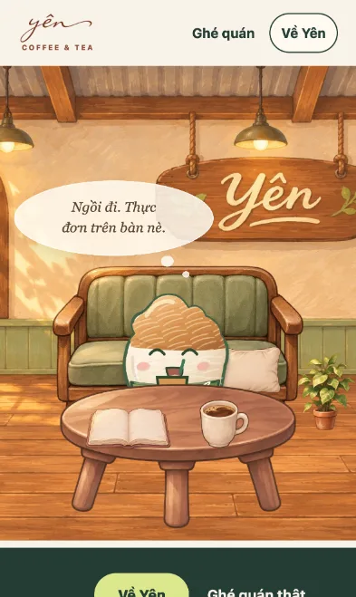 | 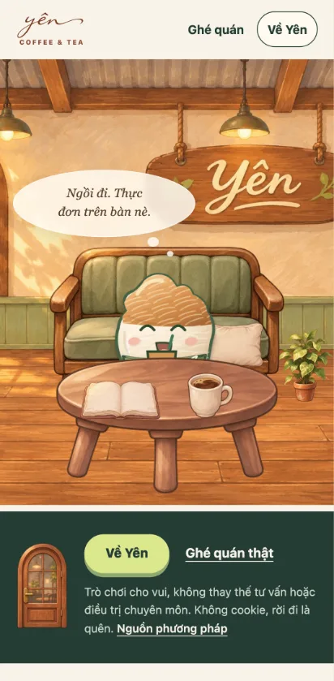 |
| Sổ thực đơn, 3 trò |  |  |
| Thở cùng Yên, đang thở | 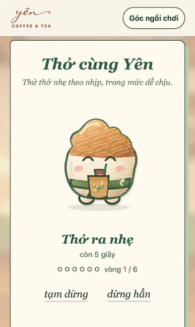 | 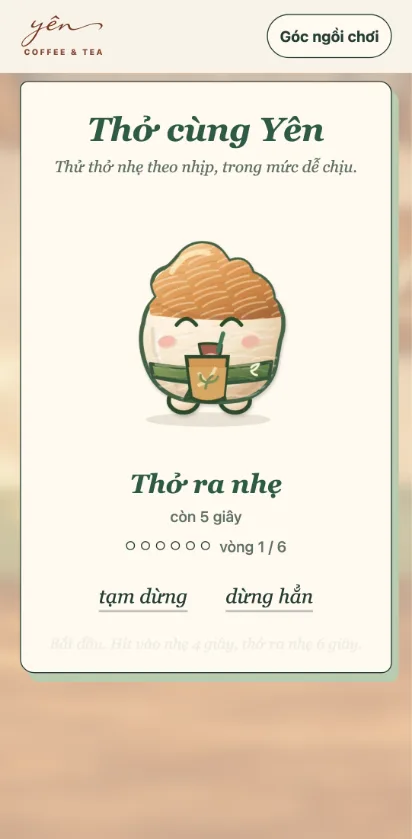 |
| Thở cùng Yên, xong | 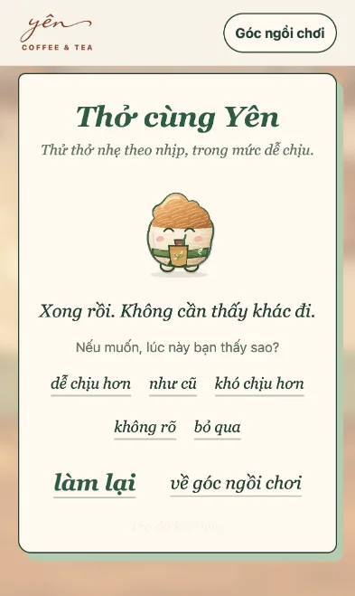 | 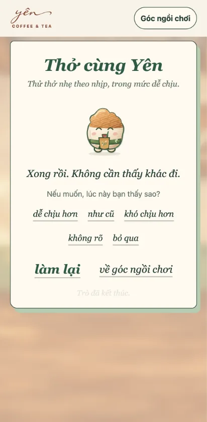 |
| Căng rồi thả, đang chơi | 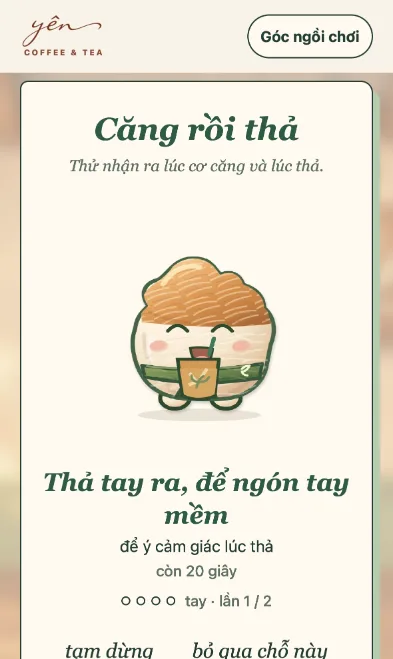 | 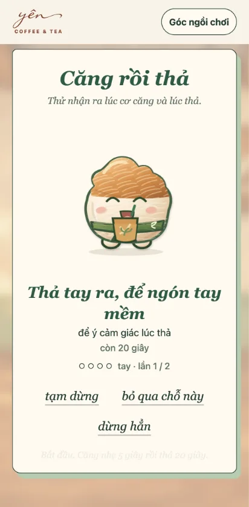 |
| Căng rồi thả, xong | 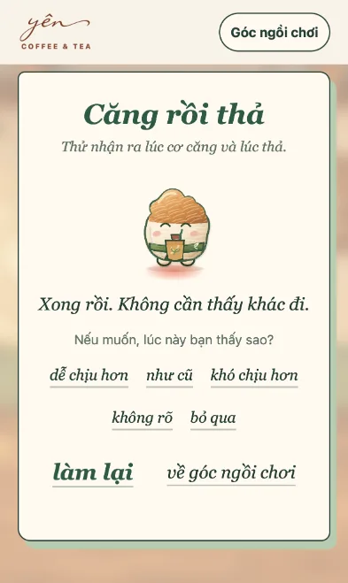 | 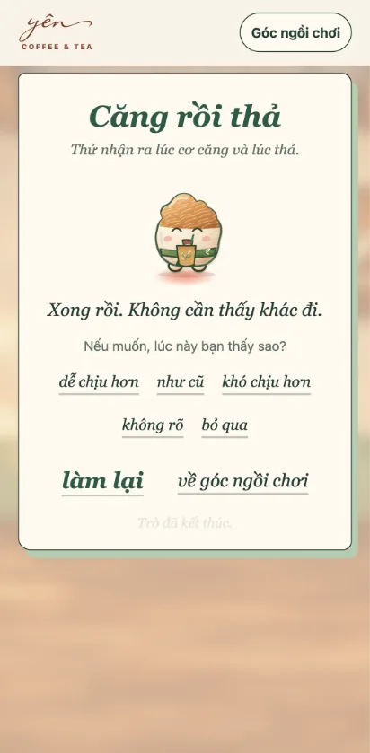 |
| Ba điều nhỏ xíu, đang viết | 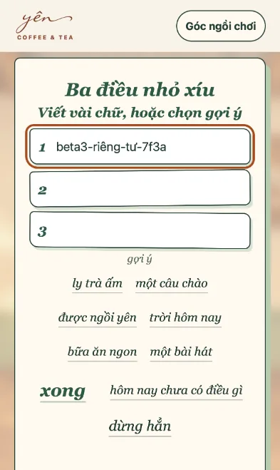 | 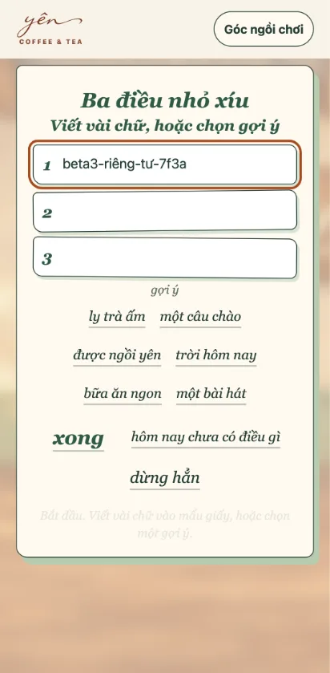 |
| Ba điều nhỏ xíu, xong |  | 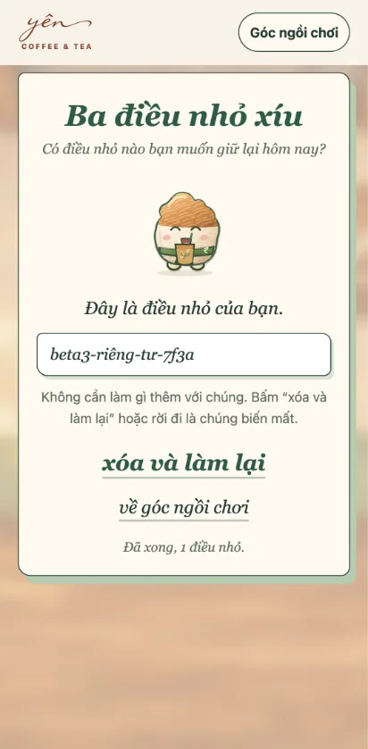 |

Chạy lại (cần `npx playwright install webkit chromium`):

```bash
LAB_UX_DEVICES=1 LAB_BETA3_SHOTS=docs/yen-lab/release/beta3 npx playwright test --config playwright.lab-ux.config.mjs --project iphone-webkit --project android-chromium tests/yen-lab-beta3.spec.mjs
```

Ảnh gốc 3× được thu về 1× WebP. Ghi chú kỹ thuật: đồng hồ giả của Playwright cũng đóng băng animation CSS, nên ảnh “Ba điều nhỏ xíu, xong” lấy từ lượt chạy thời gian thật (bài offline). `screenshot()` của Playwright chèn một `<style>` mà CSP của Lab chặn trên WebKit; chỉ lượt chụp ảnh (tùy chọn) bỏ qua đúng thông báo đó, lượt CI không chụp ảnh nên vẫn kiểm chặt (lượt chụp ảnh vì thế không bắt được một `<style>` inline mới bị CSP chặn).

## Cold load (desktop Chromium, server cục bộ, cache trống)

| Trang | Dữ liệu | Request | load |
| --- | --- | --- | --- |
| `/lab/` | 700 KB | 14 | 67 ms |
| `/lab/tho/` | 483 KB | 10 | 80 ms |
| `/lab/cang/` | 488 KB | 10 | 99 ms |
| `/lab/ba-dieu/` | 472 KB | 9 | 86 ms |

Chỉ tính tài nguyên tải trước sự kiện `load` (lần vẽ đầu), không phải cả lượt chơi. Thời gian là máy cục bộ, không phải mạng điện thoại; dùng để bắt hồi quy về dung lượng và số request, không phải cam kết tốc độ thật. Phòng nặng nhất vì có tranh nền và dải 8 khung lật sổ (`book-flip.avif`, #188).

## Production

- Trước cổng này: production phục vụ `022a2d56d6fa863577bd2c68ca33293468bf6ec3` (deploy `6aff2ad1ad318f9c95ca8b89`, gồm #185 Ba điều nhỏ xíu, #188 sổ lật trang, #189 bộ sprite), deployed smoke run 44572144238 36/36.
- SHA của chính cổng này: ghi vào #135 sau khi merge và deployed smoke trên production pass.

## Rollback

1. Ẩn link Lab ở homepage: `var flag_yenlab = 0;` trong `index.html`.
2. Gỡ một trò khỏi sổ: revert PR của trò đó (#179, #183, #185).
3. Thay đổi của cổng này chỉ là test + một dòng CSS: revert PR này.

## Còn mở (không chặn cổng, cần chủ quán)

- Thử trên iPhone và Android **thật** cả 3 trò, và một lượt VoiceOver/TalkBack nếu được. Agent không có máy thật/Simulator.
- Tranh sổ lật trang (#188) và bộ sprite (#189) do agent tự duyệt; chủ quán duyệt lại sau. Dải lật trang của #188 khá mờ khi phóng to; bộ khung 410 px của #189 nét hơn nhưng còn viền giấy răng cưa ở mép trên, chưa thay vào phòng.
