# Yên Lab · M3 Beta 6 release gate (LAB-F13, #137)

Ngày: 20/11/2026 · Cổng M3: **sáu trò cùng mở**. Ba trò của Beta 3 (Thở cùng Yên, Căng rồi thả, Ba điều nhỏ xíu) cộng ba trò M3 (Thám tử hiện tại, Lá trôi, nghĩ trôi, Gọi tên cơn bực), và gợi ý trò qua Cục Yên (F12). Một lượt khách đi hết: phòng → sổ hoặc Cục Yên → từng trò → về phòng.

Các trò và gợi ý đã lên production qua PR riêng (#193 G05, #195 G07, #197 G09, #199 F12). Cổng này kiểm cả sáu **cùng nhau**, và thêm phần ticket yêu cầu: câu hỏi tùy chọn “thấy khác đi chút nào không?” cho ba trò M3, chỉ trong bộ nhớ trang.

## Thay đổi trong cổng này

- **Câu hỏi sau trò** (Thám tử hiện tại, Lá trôi nghĩ trôi, Gọi tên cơn bực): sau khi xong hoặc dừng, “Nếu muốn, lúc này bạn thấy sao?” với dễ chịu hơn / như cũ / khó chịu hơn / không rõ / bỏ qua. Đây là cùng mẫu đã có ở Thở cùng Yên và Căng rồi thả.
  - Câu trả lời không lưu, không gửi, không đổi gì; chạm xong là câu hỏi ẩn đi.
  - “khó chịu hơn” nhận một lời mời nghỉ riêng cho từng trò, ví dụ “Cảm ơn bạn đã nói. Nghỉ một chút nhé; không cần nghĩ tiếp hay làm lại.”
  - Ba điều nhỏ xíu giữ nguyên như đã phát hành.
- `tests/yen-lab-beta6.spec.mjs` (mới; chạy trong CI qua `playwright.lab-ux.config.mjs`, và trên điện thoại giả lập khi `LAB_UX_DEVICES=1`):
  - **Một lượt khách, 6 trò:** năm trò mở từ sổ, Lá trôi mở từ lời gợi ý của Cục Yên. Mỗi trò chơi đến hết rồi “về góc ngồi chơi”. Không có lỗi console/JS, không HTTP ≥ 400, không cookie/storage. Không âm thanh: đã đếm Web Audio, media, speech, rung và `<audio>/<video>`.
  - **Câu hỏi sau trò:**
    - Ẩn ngay trong markup (`hidden`); không hiện lúc chờ hay đang chơi.
    - Trả lời rồi thì ẩn; “khó chịu hơn” nhận lời mời nghỉ; vẫn có sau khi dừng.
    - Không request, storage hay URL.
    - Chạm đúp một chữ ở 320 px không rời trang: khi câu hỏi thu lại, “về góc ngồi chơi” trượt lên dưới ngón tay, và cú chạm thứ hai trong 400 ms bị bỏ.
  - **Offline:** sau khi tải, mỗi trò trong 6 trò chơi được đến hết mà không gọi mạng lần nào.
  - **Rà câu chữ (hai lớp):**
    - (1) chữ của phòng và 6 trang trò như server trả về: kể cả trạng thái chưa hiện và noscript.
    - (2) mọi chuỗi chữ trong script của Lab: câu Cục Yên, lời thông báo, câu dẫn từng bước, dòng kết quả, lời đáp sau trò.
    - Cả hai đều không được có: chữa / trị liệu / điều trị / chẩn đoán / bệnh danh / “được chứng minh” / hiệu quả / hết lo, hết bực / xóa suy nghĩ / giảm căng thẳng / hạch hạnh nhân / đảm bảo / reset não / tần số.
    - Chữ được chuẩn hóa NFC và chữ thường trước khi so.
    - Chỉ cho phép “không thay thế tư vấn hoặc điều trị chuyên môn”, “chưa được kiểm chứng hiệu quả” và tên nguồn “liệu pháp ACT”.
    - Mọi trang có câu “không thay thế…”; mọi trò có “chưa được kiểm chứng hiệu quả”.
    - Đã thử: thêm “xóa suy nghĩ tiêu cực” vào một trang, hoặc “hết lo” vào một câu của Cục Yên trong script, thì bài này fail.
  - **Cold load:** 7 trang, ngân sách < 900 KB, ≤ 25 request, 0 bên thứ ba.

Không đổi engine, CSP, sổ thực đơn hay copy chính của trò.

## Checklist #137

| Tiêu chí | Kết quả | Bằng chứng |
| --- | --- | --- |
| 6 trò có hành vi thật, thoát/làm lại, không thẻ hỏng | ✅ | Lượt khách 6 trò (desktop, chạm giả lập, iPhone 15 WebKit, Pixel 7) + spec từng trò (bắt đầu/dừng/làm lại/xong). Sổ: 6 link mở, trang 2 chỉ là chữ không bấm được |
| Grounding là quan sát thật, không phải tìm đồ trên màn hình; 5 giác quan là hướng dẫn, không là chuẩn khoa học | ✅ | Thám tử hiện tại: không ô nhập, tranh chỉ minh họa, “manh mối ở ngoài đời, trang chỉ đếm giúp bạn”; mùi/vị “không có cũng được”; fine print “chưa có nghiên cứu trực tiếp đủ mạnh” (G05-THAM-TU.md) |
| Gọi tên cảm xúc không gán nhãn bệnh; lá trôi không hứa chữa suy nghĩ | ✅ | Gọi tên: chỉ hiện chữ đã chọn, có “khác” / “không biết gọi tên”, không diễn giải; Lá trôi: “Thử nhìn một ý nghĩ đi ngang.”, không “xóa suy nghĩ”; bài rà câu chữ ở trên |
| Feedback tùy chọn chỉ trong RAM, không analytics | ✅ | Câu hỏi sau trò ở 5 trò: Thở, Căng (có sẵn), Thám tử, Lá trôi, Gọi tên (cổng này). Ba điều nhỏ xíu không có: trò đã kết thúc bằng chính các mẩu giấy của khách. Không lưu, không request; bản ghi review câu chữ trong EVIDENCE.md (20/11/2026, Beta 6) |
| Regression | ✅ | Lab UX (desktop + chạm giả lập) 375 pass, 9 skip · điện thoại giả lập 302 pass, 14 skip · smoke 5 khung 55 pass, 2 skip (bài chỉ chạy trên site đã deploy) · node 26/26 · foundation, privacy, UI audit OK |
| Reduced motion / VoiceOver | ✅ / ⏳ | Reduced motion: mỗi trò có bài hoàn tất không animation. VoiceOver/TalkBack **chưa thử trên máy thật**; các bài chỉ kiểm nhãn, nhóm, `aria-pressed`, vùng thông báo và focus. Sau “dừng hẳn”, focus vào “chơi lại”, nằm sau câu hỏi trong thứ tự đọc (như Thở/Căng): người dùng trình đọc màn hình có thể lướt qua câu hỏi; câu hỏi là tùy chọn |
| SHA production, P0/P1 = 0 | ✅ | `364e7aa`, deployed smoke 44673870038 57/57; xem “Production” |

## Điện thoại giả lập

iPhone 15 trên **WebKit 26.5** (engine Safari) và Pixel 7 trên **Chromium 151**. Đây là giả lập, **không phải máy thật**.

| Bước | iPhone 15 · WebKit 26.5 | Pixel 7 · Chromium 151 |
| --- | --- | --- |
| Phòng | 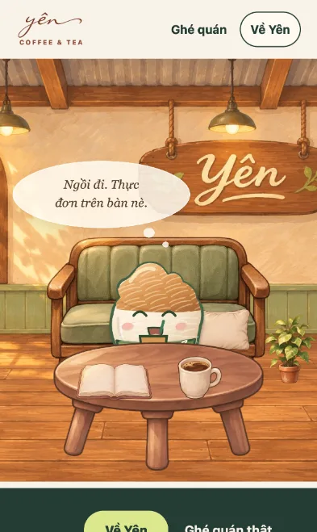 | 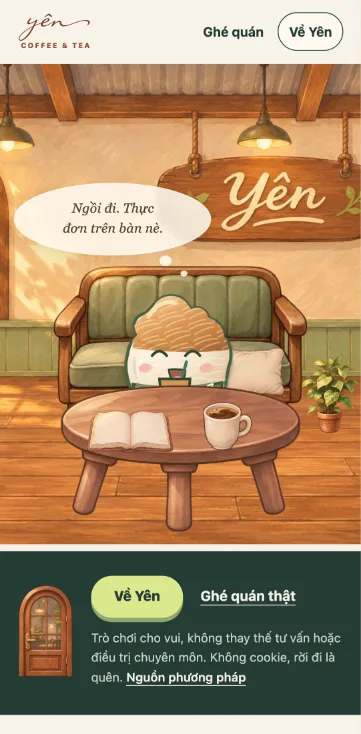 |
| Sổ thực đơn, 6 trò |  | 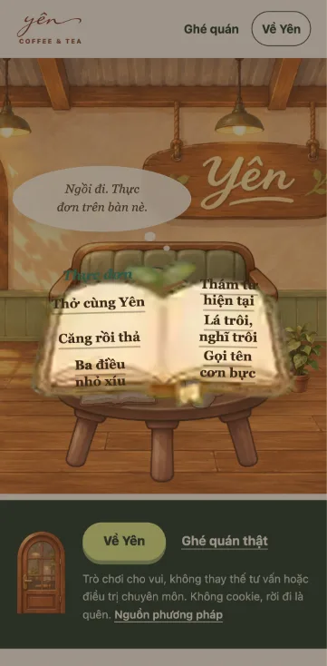 |
| Cục Yên gợi ý | 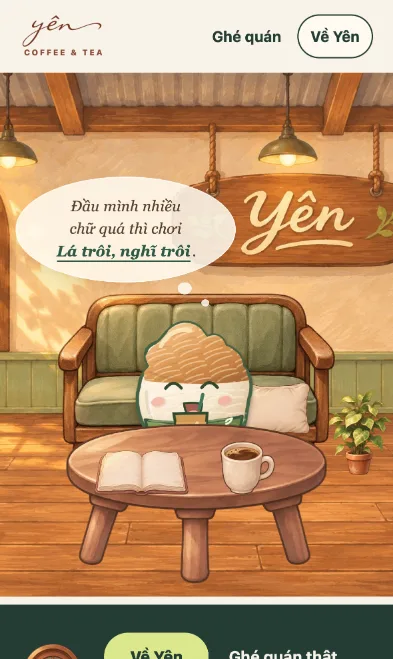 | 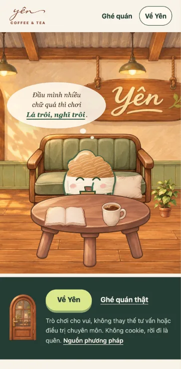 |
| Thở cùng Yên, xong | 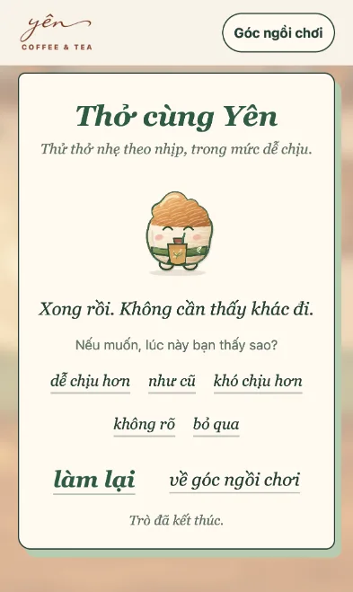 | 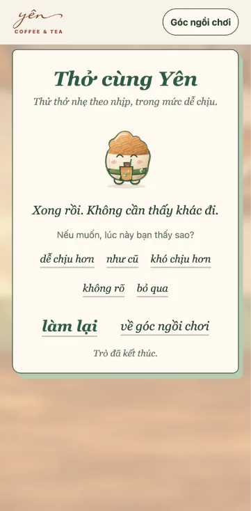 |
| Căng rồi thả, xong | 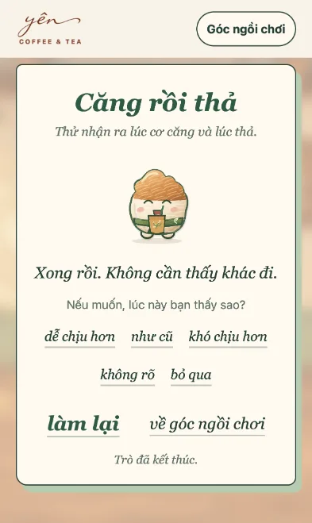 | 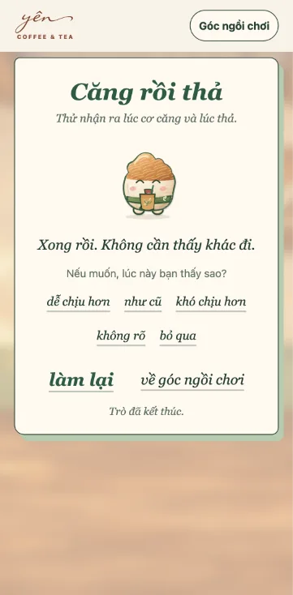 |
| Ba điều nhỏ xíu, xong | 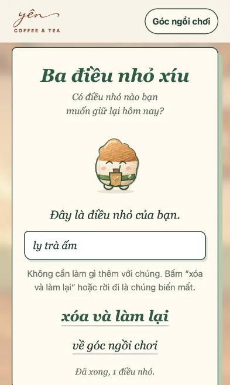 | 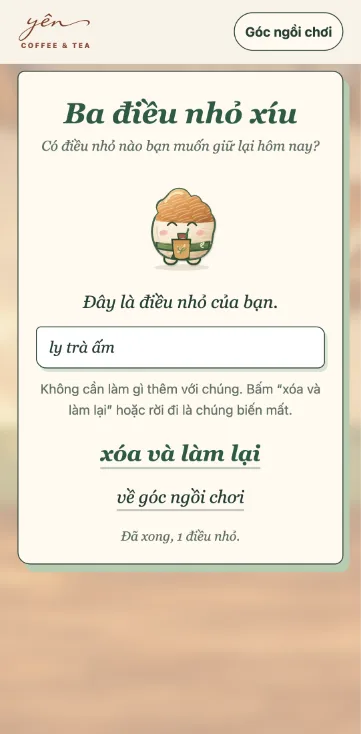 |
| Thám tử hiện tại, xong | 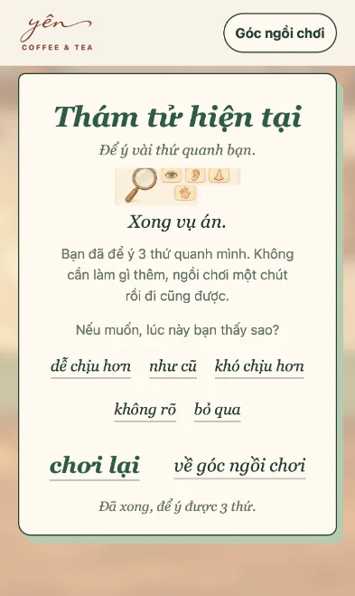 | 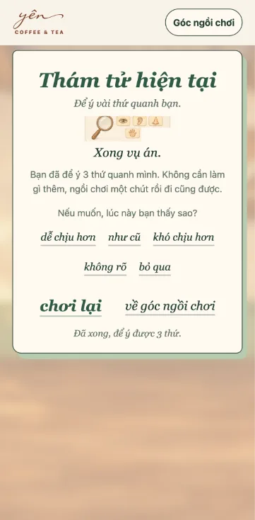 |
| Lá trôi, nghĩ trôi, xong | 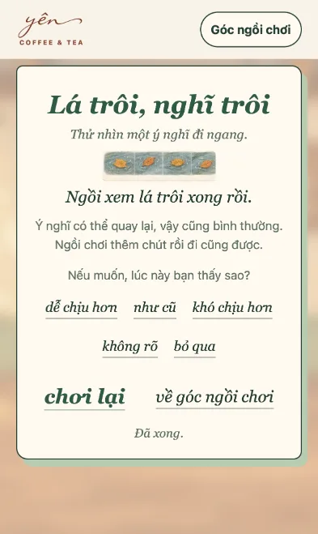 | 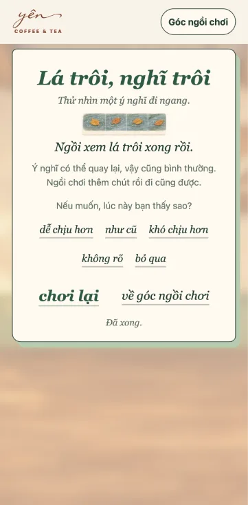 |
| Gọi tên cơn bực, xong | 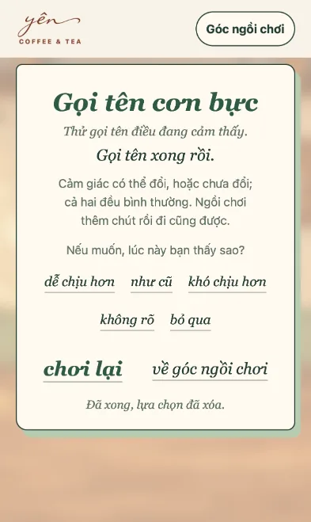 | 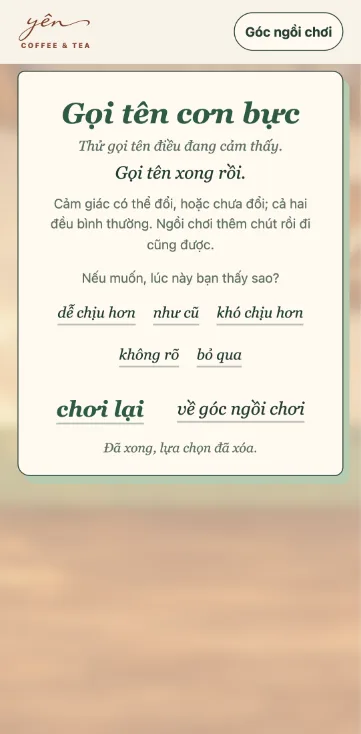 |

Chạy lại (cần `npx playwright install webkit chromium`):

```bash
LAB_UX_DEVICES=1 LAB_BETA6_SHOTS=<thư mục> npx playwright test --config playwright.lab-ux.config.mjs --project iphone-webkit --project android-chromium -g "one guest visit" tests/yen-lab-beta6.spec.mjs
```

Ảnh iPhone chụp ở 3× rồi thu về 1× WebP (393 px). Ảnh Pixel 7 chụp ở 2.625× và thu cùng tỉ lệ nên nhỏ hơn 1× một chút (361 px cho khung 412 px). Ghi chú kỹ thuật:
- Đồng hồ giả của Playwright đóng băng animation CSS giữa chừng, nên lượt chụp ảnh cho mọi animation chạy tới khung cuối trước khi chụp (`getAnimations().finish()`).
- Lượt chụp ảnh bỏ qua đúng thông báo CSP về `<style>` mà `screenshot()` chèn vào trên WebKit. Lượt CI không chụp ảnh nên vẫn kiểm chặt.

## Cold load (desktop Chromium, server cục bộ, cache trống)

| Trang | Dữ liệu | Request | load |
| --- | --- | --- | --- |
| `/lab/` | 721 KB | 14 | 41 ms |
| `/lab/tho/` | 495 KB | 10 | 47 ms |
| `/lab/cang/` | 500 KB | 10 | 50 ms |
| `/lab/ba-dieu/` | 470 KB | 8 | 48 ms |
| `/lab/tham-tu/` | 465 KB | 9 | 43 ms |
| `/lab/la-troi/` | 470 KB | 9 | 45 ms |
| `/lab/goi-ten/` | 469 KB | 9 | 44 ms |

Chỉ tính tài nguyên tải trước `load`. Thời gian đo trên máy cục bộ, dùng để bắt hồi quy về dung lượng và số request, không phải cam kết tốc độ trên mạng điện thoại.

## Production

- Trước cổng này: production phục vụ `519115061a88b53ed52a61f1a6e35dfcb6382073` (gồm G05 #193, G07 #195, G09 #197, F12 #199 và các bản ghi roadmap); mỗi PR có deployed smoke riêng (gần nhất: run 44668350582, 57/57 ở `e3b8313`).
- Cổng này: PR #203 squash-merge thành `364e7aacc40d0761e01ef5aa222ab47f85beb3fe`; production `build-info.json` phục vụ đúng SHA đó, deployed smoke run 44673870038 57/57 (20/11/2026). Kiểm tay trên production: Thám tử hiện tại → dừng hẳn → “khó chịu hơn” → lời mời nghỉ, focus về “chơi lại”, không storage, không request bên thứ ba. P0/P1 mở: 0.

## Rollback

1. Ẩn link Lab ở homepage: `var flag_yenlab = 0;` trong `index.html`.
2. Gỡ một trò khỏi sổ: revert PR của trò đó (#193, #195, #197). Lời gợi ý của Cục Yên: revert #199.
3. Thay đổi của cổng này: revert PR này. Nó chỉ gồm câu hỏi sau trò ở 3 trò M3 (và chặn chạm đúp trên câu hỏi đó) cùng phần test/tài liệu.

## Còn mở (không chặn cổng, cần chủ quán)

- Thử trên iPhone và Android **thật**, và một lượt VoiceOver/TalkBack nếu được. Agent không có máy thật.
- Duyệt câu chữ, danh sách từ cảm xúc của Gọi tên cơn bực và tranh: tất cả đang do agent tự duyệt; chủ quán duyệt sau.
- Tranh G05 (#189) đang cắt ô lá. Kính lúp sạch trong bộ #191 có thể thay vào khi chủ quán duyệt bộ đó.
