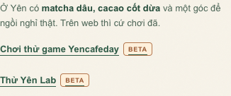
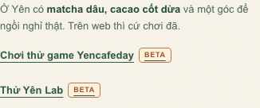
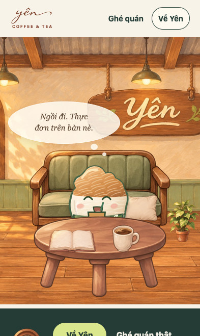
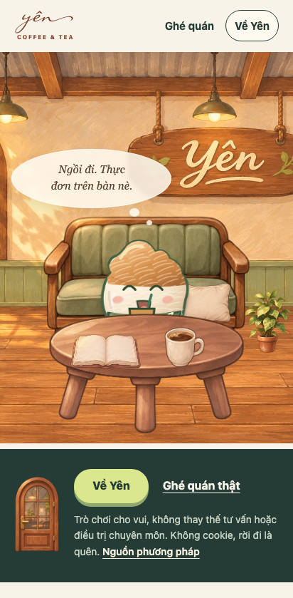
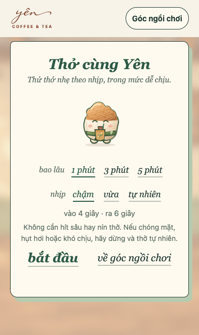
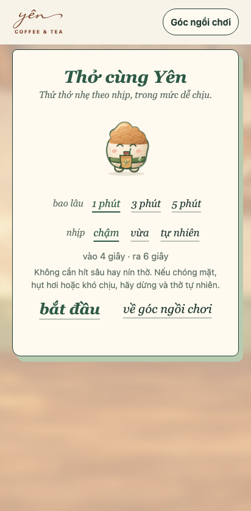
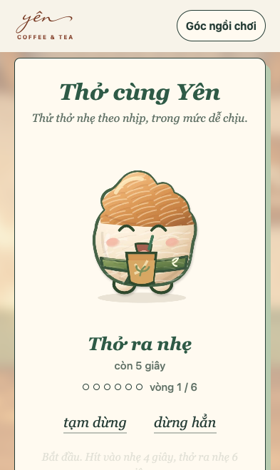
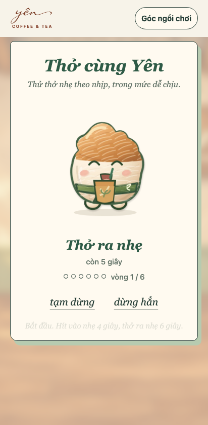
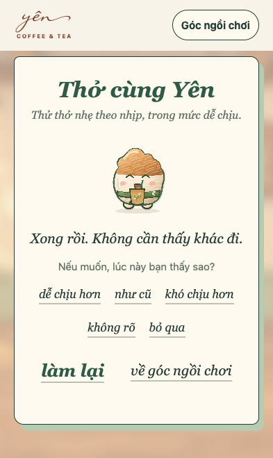
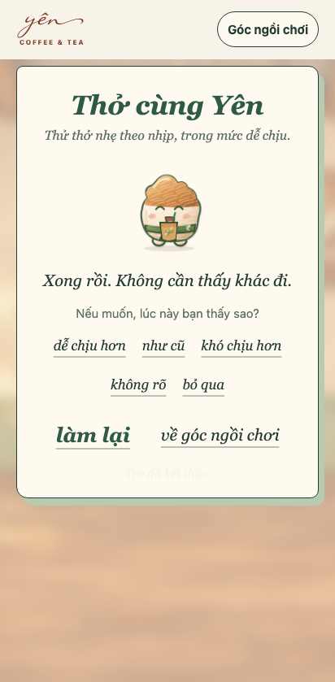

# Yên Lab · M1 Playable Alpha release (LAB-F10, #134)

Ngày: 19/11/2026 · Cổng M1: **homepage → `/lab/` → Thở cùng Yên**. Trạng thái phát hành, SHA và URL production: ghi trong #134 sau khi merge và deployed smoke chạy xong.

## Thay đổi trong bản phát hành

- `index.html`: `flag_yenlab = 1` → hiện liên kết “Thử Yên Lab · BETA” trong đoạn giới thiệu đầu trang (cạnh liên kết game cũ).
- `index.html`: hai liên kết chữ trong đoạn giới thiệu nằm trong một hàng riêng `.yen-hero-links` dưới câu chữ, mỗi liên kết cao 44px (lỗi từ review PR #167: cao 21px trên điện thoại). Đoạn chữ phía trên giữ khoảng dòng bình thường.
- `lab/lab.js` + `lab/index.html` + `lab/lab.css`: mở/gấp sổ bằng chạm không còn khung cam quanh cuốn sổ trên iPhone WebKit (mở: focus vào chính dialog; gấp: focus trả về sổ nhưng không vẽ viền cho tới khi người dùng bấm phím). Mở bằng bàn phím vẫn focus nút gấp sổ có viền.
- Không đổi trò, engine, CSP hay dữ liệu. Phaser game không bị động tới.

## Checklist cổng M1

| Mục | Kết quả | Bằng chứng |
| --- | --- | --- |
| F03–F09 + G01 đã xong, có code và test trên production | ✅ | #127 #128 #129 #130 #131 #132 #133 #142 đóng kèm SHA production |
| Khách từ homepage chơi được Thở cùng Yên, không đăng nhập | ✅ | `yen-lab-route.spec.mjs`: homepage → link → phòng → sổ → trò → bắt đầu → hoàn tất; back/forward không tự chạy |
| Browser tests | ✅ | Lab Playwright 126/126 (Chromium desktop + touch giả lập); smoke 5 khung; privacy; deployed smoke trên preview của PR |
| iPhone | ⚠️ **giả lập** | WebKit 26.5 (engine của Safari) với hồ sơ iPhone 15: 37/37 bài trò + route + privacy, ảnh bên dưới. **Chưa kiểm tra trên iPhone thật** (máy chạy không có Xcode/Simulator). |
| Android | ⚠️ **giả lập** | Chromium 151 với hồ sơ Pixel 7: 37/37, ảnh bên dưới. **Chưa kiểm tra trên Android thật.** |
| Bàn phím | ✅ | Tab/Enter/Space/Escape ở phòng, sổ, trò (Chromium); Option+Tab ở WebKit như Safari |
| Reduced motion | ✅ | Không animation, trò vẫn hoàn tất (kể cả bật giữa chừng) |
| Screen reader | ⚠️ một phần | Nhãn, live region, thông báo pha có test tự động; **chưa nghe thử bằng VoiceOver/TalkBack thật** |
| P0/P1 | ✅ 0 mở về code | Review độc lập từng PR đã sửa hết P0/P1 code trước khi merge (PR này: viền focus khi gấp sổ, số liệu ghi chú). Còn mở: kiểm tra trên điện thoại thật là tiêu chí của #134 mà agent không tự làm được. |
| Copy riêng tư / bằng chứng | ✅ | SAFETY.md nguyên văn; check tĩnh chặn câu hứa hẹn sức khỏe; EVIDENCE G01 re-review 1–5 phút |
| SHA + URL production, rollback dễ | sau merge | Workflow deployed smoke ghi SHA; xem phần Rollback |

## Ảnh (giả lập, 1×)

| Bước | iPhone 15 · WebKit 26.5 | Pixel 7 · Chromium 151 |
| --- | --- | --- |
| Link ở homepage |  |  |
| Phòng |  |  |
| Sổ thực đơn |  |  |
| Trò, trước khi bắt đầu |  |  |
| Đang thở |  |  |
| Xong |  |  |

Chạy lại: `LAB_UX_DEVICES=1 npx playwright test --config playwright.lab-ux.config.mjs --project iphone-webkit --project android-chromium` (cần `npx playwright install webkit chromium`).

## Rollback

1. Nhanh nhất: trong `index.html` đặt `var flag_yenlab = 0;` → link homepage ẩn (test `yen-lab-route.spec.mjs` kiểm cả đường này). `/lab/` và trò vẫn truy cập trực tiếp được.
2. Gỡ hẳn trò khỏi thực đơn: revert PR #179 (sổ quay lại “sắp có”).
3. Hoặc revert PR của cổng này. Netlify deploy lại từ `main`; workflow deployed smoke xác nhận SHA mới.

## Việc còn mở sau M1

- Chủ quán mở thử trên iPhone và Android thật (link homepage → Thở cùng Yên → bắt đầu → dừng), và nếu được, bật VoiceOver/TalkBack một lượt.
- Netlify tự chèn script toolbar/drawer vào trang (tắt trong cài đặt tài khoản Netlify).
- Repo chưa có required checks (cài đặt GitHub của chủ quán).
