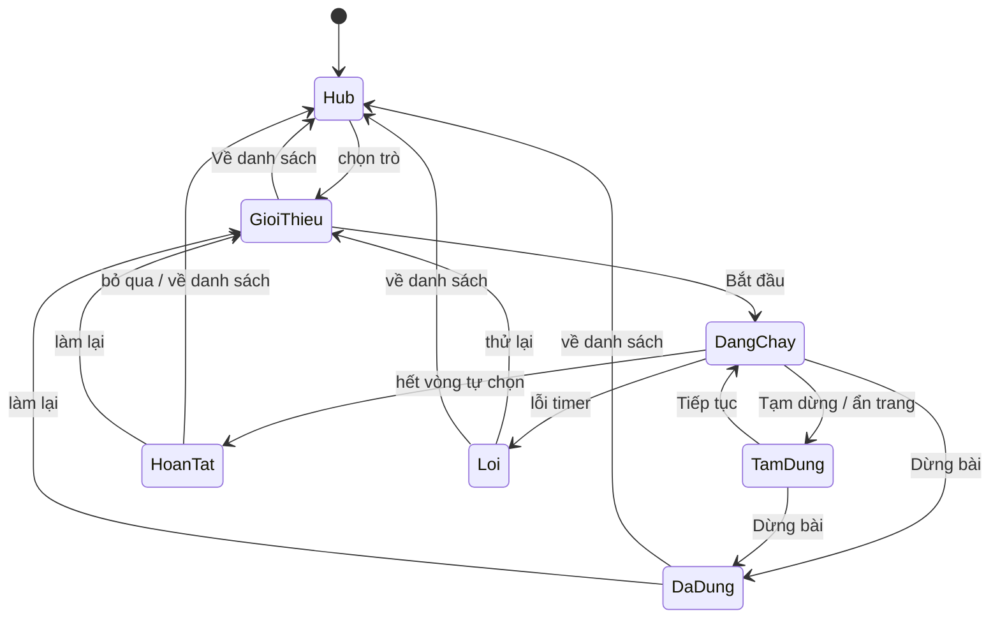

# Yên Lab · Luồng và nội dung giao diện

Ngày soạn: 19/11/2026 · LAB-F04 / #128 · M0 · Bản thiết kế, chưa phải bản phát hành.

## Phạm vi và quyết định

Giữ trang Yên hiện tại; thêm liên kết “Thử Yên Lab · Beta” tới `/lab/`. Trang Lab phục vụ một việc: chọn một bài thực hành ngắn, tự nguyện. Không chấm điểm, chuỗi ngày, sàng lọc hay suy diễn trạng thái tâm lý. Người chỉ muốn chơi có đường vào trực tiếp, không cần khai báo cảm xúc.

M1 chỉ công khai **Thở cùng Yên** sau evidence gate #127 và QA #134. Không dựng nút cho trò chưa hoạt động. Ba nhóm nhu cầu được thiết kế ở đây cho M3; chỉ bật khi mỗi nhóm có ít nhất một trò đã phát hành. Trong M1, một thẻ Thở cùng Yên đi thẳng tới phần giới thiệu và Bắt đầu. “Xem tất cả” chỉ xuất hiện khi có nhiều trò.

## Giọng điệu: góc ngồi chơi, không phải góc chữa lành (chủ quán, 19/11/2026)

Yên Lab là **góc ngồi chơi trong quán**, không phải không gian trị liệu. Hub `/lab/` nói bằng giọng Cục Yên: “ngồi chơi”, “trò”, “thực đơn”, “nội quy”, không dùng “bài thực hành”, “chữa lành”, “nhu cầu”, “căng thẳng” làm khung chính. Ba nhóm M3 đổi tên thành **Cho đầu óc nghỉ xíu / Duỗi người cái coi / Kiếm chút gì vui vui** (vẫn chỉ là cách tìm trò, không hỏi lý do).

Không đổi các ràng buộc an toàn: câu “không thay thế tư vấn hoặc điều trị chuyên môn” giữ trong Nội quy của Cục Yên; lưu ý thở/cơ vẫn đặt **cạnh nút Bắt đầu của từng trò** theo SAFETY.md; không tuyên bố hiệu quả; liên kết “Nguồn phương pháp” vẫn có. Bảng nội dung bên dưới là bản gốc F04; ở hub, câu chữ trong `lab/index.html` thay thế các dòng tương ứng. Màn giới thiệu/đang chơi của từng trò dùng cùng giọng thoải mái nhưng giữ nguyên lưu ý an toàn.

## Cấu trúc thông tin

| Vị trí | Nội dung | Hành động chính |
| --- | --- | --- |
| Homepage | Một liên kết cạnh nội dung nghỉ chơi hiện có | Thử Yên Lab · Beta |
| `/lab/` | Tên, lời mời ngắn, trò khả dụng, liên kết nguồn và riêng tư | Mở Thở cùng Yên |
| Giới thiệu trò | Tên, thời lượng, cách làm, lưu ý, phương pháp và giới hạn | Bắt đầu |
| Đang thực hành | Một hướng dẫn hiện tại, tiến độ bằng chữ, điều khiển | Tạm dừng |
| Kết thúc / dừng sớm | Phản hồi tùy chọn; bỏ qua được | Về danh sách |
| Footer | Nguồn phương pháp, riêng tư, về Yên | Về Yên |

Mở một trò từ hub: **1 tương tác để xem giới thiệu**, tối đa **2 để bắt đầu**. Khi có nhóm nhu cầu: chọn nhóm rồi chọn trò là 2 tương tác tới giới thiệu. Danh sách toàn bộ luôn ở hub; không ép qua bộ lọc. Dùng liên kết cho điều hướng và button cho đổi trạng thái; không dùng thẻ div giả nút.

## Trạng thái và điều hướng

- Dừng ngay, không hỏi “Bạn chắc chứ?”, không đếm ngược thoát. Tắt timer, motion và audio nếu có.
- Khi quay lại tab: giữ trạng thái tạm dừng, không chạy bù thời gian. Chỉ tiếp tục sau hành động của người dùng.
- Back từ bài về hub; forward trở lại giới thiệu an toàn, không tự chạy. URL chỉ chứa ID trò/trang, không chứa lựa chọn nhu cầu, cảm xúc hay nội dung viết.
- Thoát, reset, reload và pagehide xóa phản hồi/nội dung riêng tư trong bộ nhớ. Reset trở lại giới thiệu và xóa tiến độ. Không phục hồi nội dung bằng storage hay bfcache.
- Đổi màn hình: focus vào heading `tabindex=-1`; về hub thì focus lại liên kết trò trước đó. Live region chỉ thông báo mốc chính, không đọc mỗi giây. Giữ Dừng bài trong luồng DOM sau hướng dẫn, luôn nhìn thấy khi thực hành.
- Không animation vẫn có hướng dẫn pha thở bằng chữ và thời gian; không phụ thuộc màu, âm thanh hay phóng to để hiểu.

## Bộ nội dung tiếng Việt

| Ngữ cảnh | Nội dung chính xác |
| --- | --- |
| Hub heading | Yên Lab |
| Nhãn | Beta |
| Lời mời | Thử một bài ngắn. Dừng lúc nào cũng được. |
| M1 mô tả | Có một phút trống? Mình thử thở chậm cùng nhau. |
| M1 thẻ | Thở cùng Yên · Khoảng 1 phút |
| M1 mô tả thẻ | Thử thở nhẹ theo nhịp, trong mức dễ chịu. |
| Nhóm M3 | Đầu óc nhiều chuyện / Người đang căng / Muốn một điều dễ chịu |
| Giải thích nhóm | Chọn điều bạn muốn thử lúc này. Đây chỉ là cách tìm bài. |
| Xóa nhóm | Xem tất cả bài |
| Trước khi bắt đầu | Không cần hít sâu hay nín thở. Nhịp gợi ý chỉ để tham khảo; bạn có thể giữ nhịp tự nhiên hoặc chỉ quan sát. |
| Lưu ý thở | Nếu chóng mặt, hụt hơi hoặc khó chịu, hãy dừng và thở tự nhiên. Bạn có thể chọn bài khác. |
| Nhãn phương pháp | Dựa trên kỹ thuật thở đã được nghiên cứu |
| Nguồn | Bản thực hành ngắn này chưa được kiểm chứng hiệu quả riêng. |
| Nút bắt đầu | Bắt đầu |
| Pha thở | Hít vào nhẹ / Thở ra nhẹ |
| Thông tin tiến độ | Vòng 1 / 6 (số vòng cấu hình theo evidence review) |
| Điều khiển | Tạm dừng / Tiếp tục / Dừng bài |
| Tạm dừng | Đang tạm dừng. Cứ thở theo nhịp của bạn. |
| Dừng sớm | Mình dừng ở đây nhé. |
| Hoàn tất | Bài đã kết thúc. Bạn không cần thấy khác đi. |
| Phản hồi | Nếu muốn, bạn thấy lúc này thế nào? |
| Phản hồi lựa chọn | Dễ chịu hơn / Như cũ / Khó chịu hơn / Không rõ / Bỏ qua |
| Sau phản hồi | Cảm ơn bạn đã tự để ý một chút. |
| Làm lại | Làm lại bài |
| Quay lại | Về danh sách |
| Thoát site | Về Yên |
| Riêng tư | Không lưu hoặc gửi lựa chọn và nội dung bạn nhập. Rời bài là xóa. |
| Giới hạn | Bài thực hành tự nguyện, không thay thế tư vấn hoặc điều trị chuyên môn. |
| Lỗi | Bài chưa chạy được. Bạn có thể thử lại hoặc về danh sách. |
| Nút lỗi | Thử lại / Về danh sách |
| Không JS | Bài tương tác cần JavaScript. Bạn vẫn có thể đọc cách làm và về Yên. |

Không gửi phản hồi tới server, analytics, URL, cookie, localStorage hay sessionStorage. Không tổng hợp tỷ lệ “thấy tốt hơn” từ lựa chọn chưa được phép thu thập. Nút nguồn mở tài liệu phương pháp, không mở form thu thập thông tin.

## Bố cục và wireframe

[`wireframes.html`](wireframes.html), [`wireframes.css`](wireframes.css) và [`wireframes.js`](wireframes.js) là **prototype thiết kế tương tác**, không phải mini tool. Cùng một giao diện responsive dùng để walkthrough ở **360×800** và **1440×900** (và các chiều rộng QA 320/390/768), không đặt trang lớn trong khung gây tràn viewport. Banner luôn ghi rõ bản mẫu. Không dùng prototype như chứng cứ đã triển khai `/lab/`.

Prototype cho thử ba nhóm nhu cầu và danh sách ba trò mẫu để nghiệm thu IA M3; tất cả đều ghi nhãn Mẫu. M1 chỉ phát hành trò đã qua cổng riêng. Chọn nhóm là thao tác lọc thủ công trong DOM, không đưa nhu cầu vào URL hoặc hồ sơ. Danh sách toàn bộ có ngay lúc đầu; chọn nhóm rồi mở trò mất hai thao tác, mở trực tiếp mất một. Đường dẫn hash chỉ chứa ID `breath`, `release`, `small`.

Các trạng thái prototype chạy thật bằng nút native: giới thiệu → Bắt đầu bản mẫu → đang chạy → Tạm dừng/Tiếp tục → Dừng hoặc Mô phỏng hoàn tất → phản hồi tùy chọn hoặc Về danh sách/Làm lại. “Mô phỏng lỗi” mở đường Thử lại/Về danh sách. Đây chỉ là chuyển màn hình, không chạy nhịp thở, gồng cơ, timer hay hướng dẫn thực hành của trò bị hoãn. Không có hiệu ứng chuyển động; reduced-motion có đầy đủ chức năng tương đương.

Không dùng network API, form, audio, font ngoài, cookie hay storage. CSP cho phép chỉ JS/CSS cùng origin, chặn connect/form/object/base. Phản hồi được bỏ ngay sau lần bấm, không giữ giá trị lựa chọn; chỉ hiện lời cảm ơn trung tính. Về hub, reset, pagehide hoặc phục hồi bfcache đều xóa thông báo và trở lại trạng thái an toàn. Back/forward mở hub/giới thiệu, không tự chạy lại. Prototype quản lý focus heading và trả focus về trò trước đó trên hub. Đây là prototype focus/hash flow, chưa chứng minh engine timer hay privacy của `/lab/` tương lai.

Prototype mobile: lề 20px; header gọn với Về Yên; heading + lời mời, ba nhóm nhu cầu và danh sách trò xếp dọc; nguồn/riêng tư phía dưới. Desktop: vùng nội dung tối đa 1120px, phần giới thiệu hai cột và danh sách ba trò theo hàng. Bản M1 tương lai chỉ có một trò khả dụng, không nhân đôi thẻ cho đủ chỗ. Dùng giấy `#f7f3e9`, mực `#243c35`, muted `#5f7065`, chữ giao diện từ 16px, nhãn phụ từ 14px. Noto Sans/Noto Serif nếu có tại site, fallback system; không thêm request font trong mockup.

## Walkthrough thiết kế và cổng kiểm tra

| Tình huống | Luồng đã rà trên tài liệu | Cần xác minh trên implementation |
| --- | --- | --- |
| Đang căng | Hub → Thở cùng Yên → đọc lưu ý → bắt đầu → dừng ngay → danh sách | Touch, nút dừng nhìn thấy, timer dừng, không ép phản hồi |
| Chỉ muốn chơi | Hub → mở trò trực tiếp → bắt đầu; không hỏi tâm trạng trước | Keyboard Enter/Space, focus, back/forward |
| Khó chịu trong bài | Dừng bài → thông báo trung tính → về danh sách | Screen reader, không lỗi reset, không hứa hiệu quả |

Review nội bộ bản copy: agent UX rà theo DESIGN.md và QA checklist; wording phương pháp đối chiếu EVIDENCE.md của #127 và các lưu ý riêng. Không có duyệt của chủ quán hoặc duyệt lâm sàng. Nhịp/số vòng thực hành chỉ quyết định trong #142, không mượn thao tác mô phỏng để chứng minh hiệu quả.

Prototype đã qua **10/10 bài Playwright CI** trên desktop và emulated touch 360px, bao gồm kiểm tra các chiều rộng 320/360/390/768/1440px. Coordinator đã walkthrough thật trên preview PR #166 ở 360×800 và 1440×900, kiểm tra các trạng thái và hành trình keyboard. Kết quả, screenshots và tham chiếu CI/commit được ghi trong [F04-REVIEW.md](F04-REVIEW.md); đây là chứng cứ cho prototype thiết kế, không phải bài thực hành đã phát hành.

VoiceOver/TalkBack và ngón tay trên thiết bị thật chưa xác minh. #133/#134 vẫn phải kiểm tra ứng dụng thật và production SHA riêng; không đánh dấu chúng hoàn tất từ prototype này.
