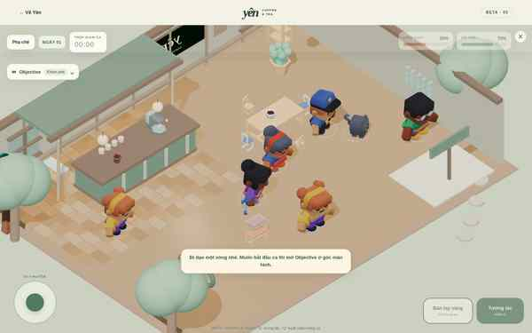
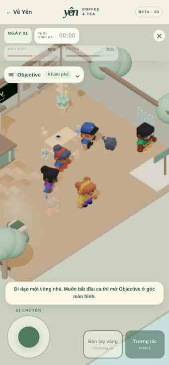

# Yencafeday BETA 03 · QA evidence

**Date:** 2026-11-16  
**Branch:** `feature/yen-game-v3-licensed-animated-assets`  
**PR:** [#80](https://github.com/vanphamvn/yen-nghi-choi/pull/80)  
**Netlify preview:** https://deploy-preview-80--yencafeday.netlify.app/game/

## Scope and results

| Category | Observation | Status |
|---|---|---|
| Binary provenance | 18 GLB files validated as GLB v2 and matched source Git blob SHA | PASS |
| Animation data | Six humanoid assets have idle/walk/interact-right, cat has idle/walk/gesture-positive | PASS |
| Automated unit tests | 23 Node test assertions in 5 test files, no failures | PASS |
| Real WebGL (desktop) | Headless Chromium, Babylon.js and all 21 scene model/container loads, zero page exceptions | PASS in test environment |
| All playable roles | Guard, shipper, barista, waiter, cat start successfully | PASS in test environment |
| Objective/shift | Open panel → Bắt đầu ca → pill becomes 1/3 → panel collapses | PASS desktop + emulated mobile |
| GLB Art Lab | Imported Kenney character-female-a GLB: 2 meshes, 32 animation clips, no page exceptions | PASS desktop |
| Mobile layout | Emulated viewport 390×844, canvas 390×788, Objective at x9/y153, joystick x10/y713, actions y764 | PASS for viewport |
| Recovery | `?classic=1` renders legacy scene and opens in khám phá mode | PASS |
| Device FPS | No measured Android/iOS physical device data | NOT VERIFIED |
| Native Safari / Android Chrome | Manual real-device smoke still required | NOT VERIFIED |
| In-game three-task playthrough | Day/shift state machine validated in Node; full movement path not manually played end-to-end in browser | PARTIAL |

## WebGL screenshot evidence

**Desktop: Chromium, 1440 × 900 viewport, screenshot resized to 600 px for GitHub**

**Mobile: Chromium device emulation, 390 × 844 viewport, screenshot resized to 340 px for GitHub**

These are actual rendered browser screenshots, not image-generation mockups. The mobile image was captured using Chromium device emulation, **not an actual iPhone or Android handset**.

## Runtime and browser instrumentation

- Vercel Sandbox Ubuntu 26.04, Playwright Chromium launched in headless mode with ANGLE SwiftShader (software WebGL).
- Scene ready console example: `Yencafeday v3 3D scene ready {assets:21,meshes:179,loadMs:571}`.
- One sampled desktop headless RAF measurement: `p50 ~60 FPS`, `p10 ~12 FPS` during a short ~1.8 s window. **This is a software-rendered CI sample, not a production device benchmark**. Avoid using it to claim 30 FPS on phones.
- No JavaScript page exceptions from the tested game or Art Lab.
- Netlify deploy preview injects its own toolbar, which triggered CSP frame/inline-style/permission warnings unrelated to the game source. Testing on Vercel/production without that toolbar is still advisable.

## Limitations and quality judgment

- The BETA 03 models are verified, textured, animated low-poly GLB assets and are visibly more coherent than the geometry-only BETA 02. They do **not** yet satisfy the original custom anime character concept gate in issue #74.
- The game is feature-complete for its **current bounded gameplay loop** (five roles, three tasks each, free roam, reset, end shift, new day), but later work is needed for unique job actions, richer NPC routines and custom character art.
- Actual iOS Safari, Android hardware performance and complete manual playthrough of every task path remain open. User-facing labeling stays BETA; old scene is available at `?classic=1`.

## Release checklist

- [x] Asset license verified and manifest pinned by SHA.
- [x] Browser GLB loading and visuals captured at desktop/mobile viewports.
- [x] All five roles boot with no page errors.
- [x] Objective and start-shift interactions work.
- [x] Fallback classic renderer works.
- [x] 23/23 automated tests pass.
- [ ] Native mobile physical-device visual/performance verification.
- [ ] Custom anime character concept and model approved.
- [ ] Manual end-to-end play of all roles/tasks on physical devices.

**Suggested release:** BETA 03 with classic fallback, clearly identified as a beta visual improvement, without claiming studio-quality art or hardware FPS guarantees.
